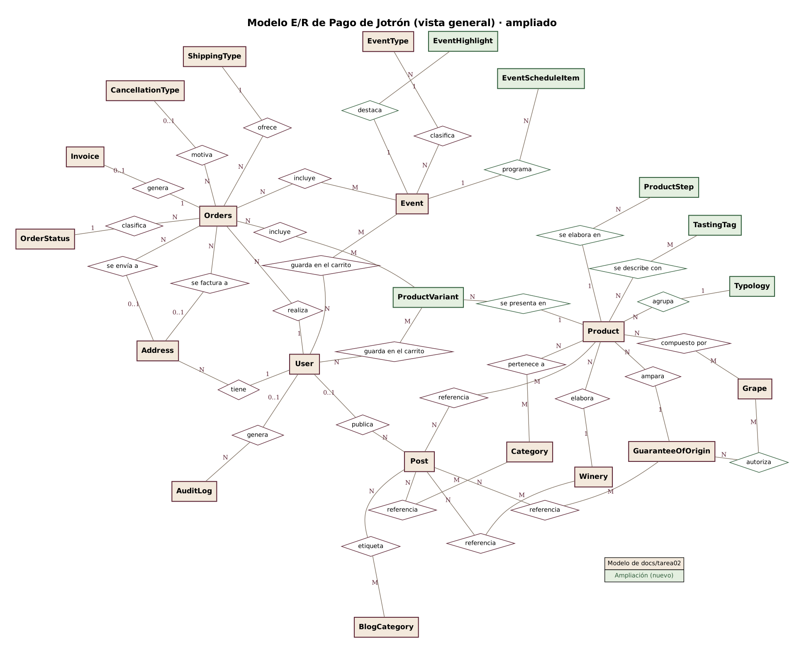
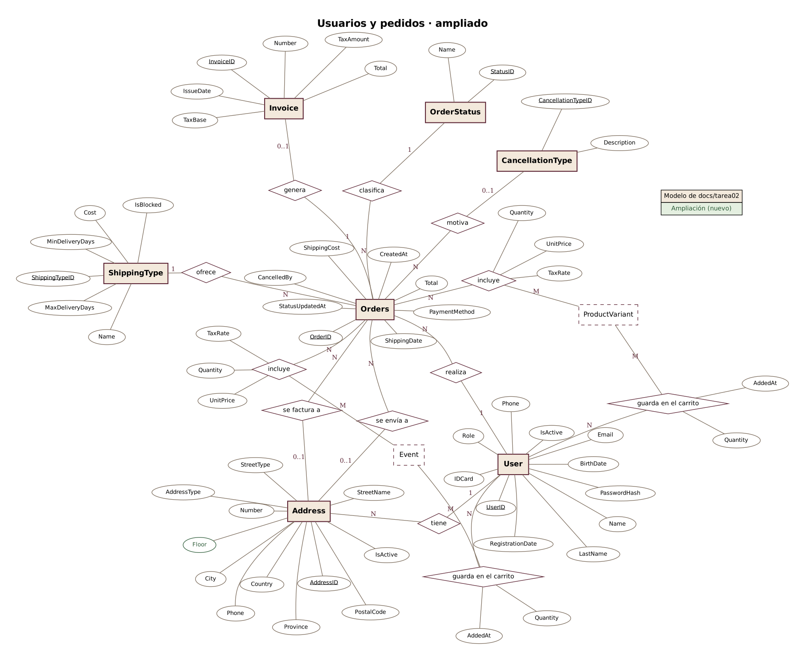
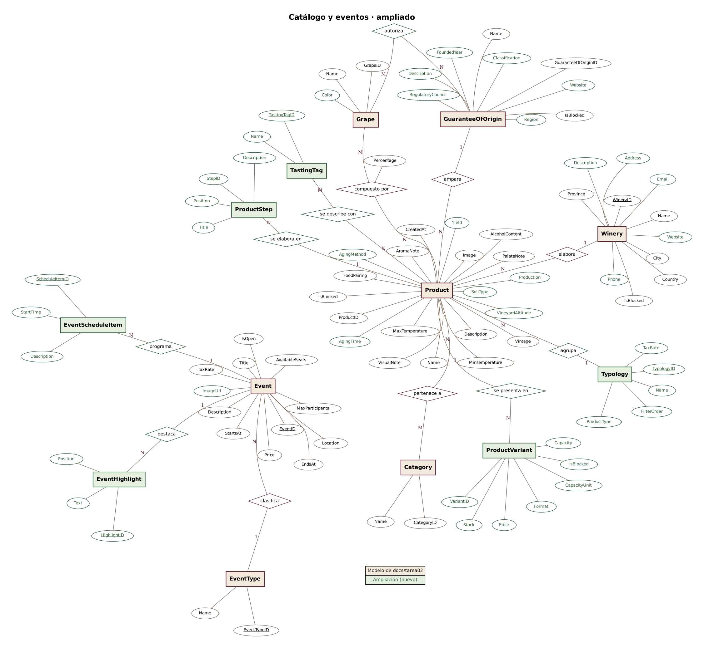
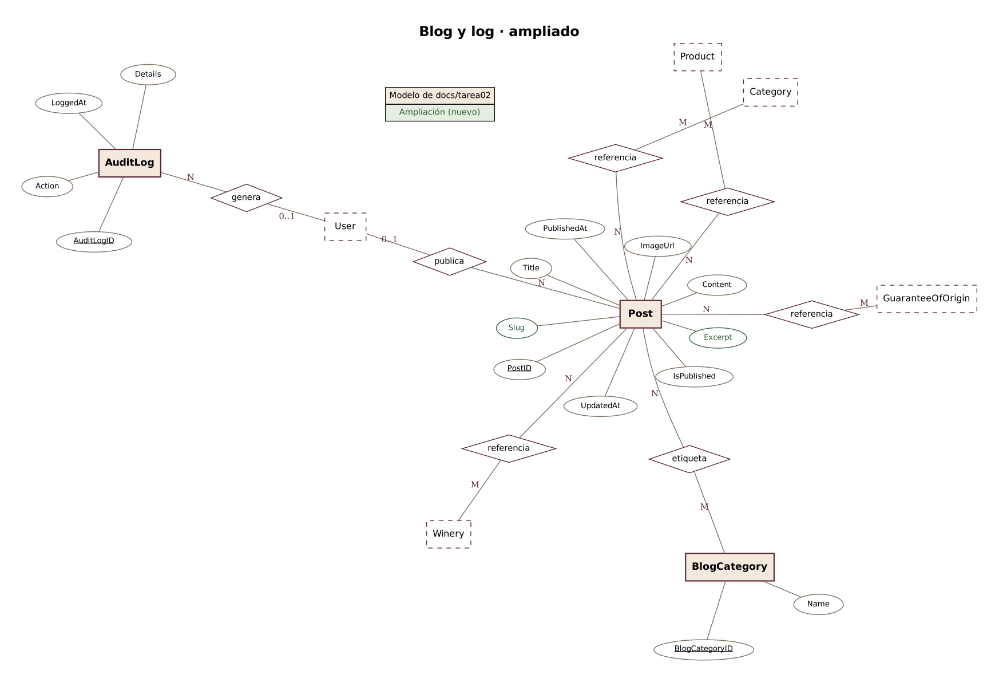
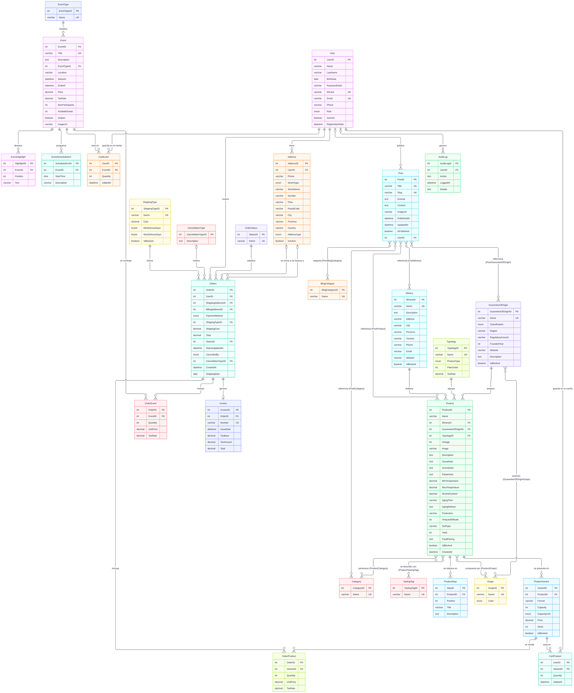

# Diseño de la base de datos — E-commerce "Pago de Jotrón" (versión ampliada)

> **Versión ampliada.** Este documento parte de `docs/tarea02/bbdd.md` y lo adapta a los campos que pide el diseño del panel de administración en Figma. El modelo pasa de **28 a 36 tablas**. Marco cada cambio con **[Ampliación]** y resumo todos en el apartado 4.1. Los datos extra de bodegas y D.O. quedan **fuera del MVP1**: el modelo los admite, pero el formulario no los pide hasta el MVP2.

En este documento desarrollo el apartado 5 del enunciado: el modelo Entidad/Relación, su paso al modelo relacional, los tipos de datos de cada campo y los scripts de la base de datos. Uso **MariaDB**, que es el gestor que ya usa el proyecto (Next.js 14 + Drizzle ORM). Los nombres de tabla y columna van en inglés; los valores del dominio (estados, tipos de envío, nombres de producto) se quedan en español.

## 1. Modelo Entidad/Relación

### 1.1. Diagrama E/R clásico

El enunciado pide el diagrama clásico, con las entidades y las relaciones separadas. Uso la notación de **Chen**:

- Las **entidades** son rectángulos y las **relaciones**, rombos con su nombre.
- Los **atributos** son óvalos. La **clave primaria** va subrayada.
- La **cardinalidad** (1, 0..1, N, M) va en cada extremo de la relación.
- Las relaciones N:M que tienen datos propios llevan sus atributos colgando del rombo (por ejemplo, `Quantity` y `UnitPrice` en "incluye").

Las claves externas no se dibujan en este diagrama, porque en el modelo E/R las representa la propia relación. Aparecen en el paso a tablas (apartado 2).

Con 24 entidades y más de 180 atributos, un único diagrama no se puede leer. Por eso lo divido en una vista general y tres diagramas por área, con todos los atributos. **[Ampliación]** Las entidades, relaciones y atributos nuevos van en **verde**.

**Vista general** (entidades, relaciones y cardinalidades):



**Usuarios y pedidos.** `ProductVariant` y `Event` aparecen con borde discontinuo porque sus atributos están en el diagrama del catálogo. **[Ampliación]** El pedido y el carrito ya no apuntan a `Product`, sino a la presentación (`ProductVariant`):



**Catálogo y eventos:**



**Blog y log de acciones:**



Los diagramas están hechos con **Graphviz**. Las fuentes son los ficheros `.dot` de la carpeta `imagenes/`.

### 1.2. Diagrama con atributos, tipos y claves

Como apoyo al paso a tablas, este diagrama muestra cada tabla con sus tipos y sus claves (PK, FK y UK). Está hecho con **Mermaid**; la fuente es `imagenes/bbdd-er.mmd`.



## 2. Paso al modelo relacional

Convierto cada entidad en una tabla y cada relación N:M en una tabla de relación, normalizando hasta la **tercera forma normal**. Las relaciones 1:N se quedan como clave externa en el lado N. Marco las claves primarias con **(PK)** y las externas con **(FK)**:

- `User (UserID PK, Name, LastName, BirthDate, PasswordHash, IDCard, Email, Phone, Role, IsActive, RegistrationDate)`
- `Address (AddressID PK, UserID FK → User, Phone, StreetType, StreetName, Number, Floor, PostalCode, City, Province, Country, AddressType, IsActive)` **[Ampliación]** `Floor`
- `Winery (WineryID PK, Name, Description, Address, City, Province, Country, Phone, Email, Website, IsBlocked)` **[Ampliación]**
- `GuaranteeOfOrigin (GuaranteeOfOriginID PK, Name, Classification, Region, RegulatoryCouncil, FoundedYear, Website, Description, IsBlocked)` **[Ampliación]**
- `Typology (TypologyID PK, Name, ProductType, FilterOrder, TaxRate)` **[Ampliación]**
- `Product (ProductID PK, Name, WineryID FK → Winery, GuaranteeOfOriginID FK → GuaranteeOfOrigin, TypologyID FK → Typology, Vintage, Image, Description, VisualNote, AromaNote, PalateNote, MinTemperature, MaxTemperature, AlcoholContent, AgingTime, AgingMethod, Production, VineyardAltitude, SoilType, Yield, FoodPairing, IsBlocked, CreatedAt)` **[Ampliación]** sin `ProductType`, `Price`, `Stock`, `Capacity`, `Size` ni `TaxRate`
- `ProductVariant (VariantID PK, ProductID FK → Product, Format, Capacity, CapacityUnit, Price, Stock, IsBlocked)` **[Ampliación]**
- `ProductStep (StepID PK, ProductID FK → Product, Position, Title, Description)` **[Ampliación]**
- `TastingTag (TastingTagID PK, Name)` **[Ampliación]**
- `Category (CategoryID PK, Name)`
- `Grape (GrapeID PK, Name, Color)` **[Ampliación]**
- `EventType (EventTypeID PK, Name)`
- `Event (EventID PK, Title, Description, EventTypeID FK → EventType, Location, StartsAt, EndsAt, Price, TaxRate, MaxParticipants, AvailableSeats, IsOpen, ImageUrl)` **[Ampliación]**
- `EventHighlight (HighlightID PK, EventID FK → Event, Position, Text)` **[Ampliación]**
- `EventScheduleItem (ScheduleItemID PK, EventID FK → Event, StartTime, Description)` **[Ampliación]**
- `OrderStatus (StatusID PK, Name)`
- `CancellationType (CancellationTypeID PK, Description)`
- `ShippingType (ShippingTypeID PK, Name, Cost, MinDeliveryDays, MaxDeliveryDays, IsBlocked)` **[Ampliación]**
- `Orders (OrderID PK, UserID FK → User, ShippingAddressID FK → Address, BillingAddressID FK → Address, PaymentMethod, ShippingTypeID FK → ShippingType, ShippingCost, Total, StatusID FK → OrderStatus, StatusUpdatedAt, CancelledBy, CancellationTypeID FK → CancellationType, CreatedAt, ShippingDate)`
- `Invoice (InvoiceID PK, OrderID FK → Orders (UNIQUE), Number, IssueDate, TaxBase, TaxAmount, Total)`
- `Post (PostID PK, Title, Slug, Excerpt, Content, ImageUrl, PublishedAt, UpdatedAt, IsPublished, UserID FK → User)` **[Ampliación]**
- `BlogCategory (BlogCategoryID PK, Name)`
- `AuditLog (AuditLogID PK, UserID FK → User, Action, LoggedAt, Details)`

### Tablas de relación (resultado de relaciones N:M)

- `ProductCategory (ProductID PK/FK → Product, CategoryID PK/FK → Category)`
- `ProductGrape (ProductID PK/FK → Product, GrapeID PK/FK → Grape, Percentage)`
- `ProductTastingTag (ProductID PK/FK → Product, TastingTagID PK/FK → TastingTag)` **[Ampliación]**
- `GuaranteeOfOriginGrape (GuaranteeOfOriginID PK/FK → GuaranteeOfOrigin, GrapeID PK/FK → Grape)` **[Ampliación]**
- `OrderProduct (OrderID PK/FK → Orders, VariantID PK/FK → ProductVariant, Quantity, UnitPrice, TaxRate)` **[Ampliación]**
- `OrderEvent (OrderID PK/FK → Orders, EventID PK/FK → Event, Quantity, UnitPrice, TaxRate)`
- `CartProduct (UserID PK/FK → User, VariantID PK/FK → ProductVariant, Quantity, AddedAt)` **[Ampliación]**
- `CartEvent (UserID PK/FK → User, EventID PK/FK → Event, Quantity, AddedAt)`
- `PostBlogCategory (PostID PK/FK → Post, BlogCategoryID PK/FK → BlogCategory)`
- `PostProduct (PostID PK/FK → Post, ProductID PK/FK → Product)`
- `PostWinery (PostID PK/FK → Post, WineryID PK/FK → Winery)`
- `PostGuaranteeOfOrigin (PostID PK/FK → Post, GuaranteeOfOriginID PK/FK → GuaranteeOfOrigin)`
- `PostCategory (PostID PK/FK → Post, CategoryID PK/FK → Category)`

## 3. Diseño lógico y tipos de datos

Para cada campo indico el tipo de dato que le va mejor en MariaDB, si forma parte de alguna clave y para qué sirve.

### 3.1. User y Address

| Tabla   | Campo            | Tipo                 | Clave     | Descripción                                                                  |
| ------- | ---------------- | -------------------- | --------- | ---------------------------------------------------------------------------- |
| User    | UserID           | `INT AUTO_INCREMENT` | PK        | Identificador único del usuario                                              |
|         | Name             | `VARCHAR(100)`       | NULL      | Nombre. **[Ampliación]** NULL: el registro no lo pide                        |
|         | LastName         | `VARCHAR(100)`       | NULL      | Apellidos. **[Ampliación]** NULL: el registro no lo pide                     |
|         | BirthDate        | `DATE`               |           | Fecha de nacimiento. Con ella se comprueba la mayoría de edad (RF2)          |
|         | PasswordHash     | `VARCHAR(255)`       |           | Hash bcrypt de la contraseña (60 caracteres, margen para futuros algoritmos) |
|         | IDCard           | `VARCHAR(20)`        | UNIQUE, NULL | NIF/NIE. **[Ampliación]** Opcional: solo hace falta para una factura completa |
|         | Email            | `VARCHAR(100)`       | UNIQUE    | Correo de inicio de sesión                                                   |
|         | Phone            | `VARCHAR(20)`        |           | Teléfono de contacto                                                         |
|         | Role             | `ENUM`               |           | Cliente, Editor o Administrador                                              |
|         | IsActive         | `BOOLEAN`            |           | False = cuenta dada de baja o desactivada                                    |
|         | RegistrationDate | `DATETIME`           |           | Fecha de alta                                                                |
| Address | AddressID        | `INT AUTO_INCREMENT` | PK        | Identificador de la dirección                                                |
|         | UserID           | `INT`                | FK → User | Usuario al que pertenece la dirección                                        |
|         | Phone            | `VARCHAR(20)`        |           | Teléfono de contacto para la entrega                                         |
|         | StreetType       | `ENUM`               |           | Tipos de vía de España: Calle, Avenida, Plaza, Paseo, Camino, Carretera, Ronda, Travesía, Glorieta, Urbanización |
|         | StreetName       | `VARCHAR(100)`       |           | Nombre de la vía                                                             |
|         | Number           | `VARCHAR(10)`        |           | Número o "s/n"                                                               |
|         | Floor            | `VARCHAR(20)`        |           | **[Ampliación]** Piso y puerta ("3º B"). Opcional                           |
|         | PostalCode       | `VARCHAR(10)`        |           | Código postal (texto, para no perder el 0 inicial de "07014")                |
|         | City             | `VARCHAR(100)`       |           | Localidad                                                                    |
|         | Province         | `VARCHAR(100)`       |           | Provincia                                                                    |
|         | Country          | `VARCHAR(100)`       |           | País, por defecto España                                                     |
|         | AddressType      | `ENUM`               |           | Envío o Facturación                                                          |
|         | IsActive         | `BOOLEAN`            |           | False = el cliente la ha quitado, pero se conserva por sus pedidos           |

### 3.2. Catálogo: Product, ProductVariant, Typology, Category, GuaranteeOfOrigin, Winery y Grape

| Tabla             | Campo               | Tipo                 | Clave                  | Descripción                                                                  |
| ----------------- | ------------------- | -------------------- | ---------------------- | ---------------------------------------------------------------------------- |
| Product           | ProductID           | `INT AUTO_INCREMENT` | PK                     | Identificador del producto                                                   |
|                   | Name                | `VARCHAR(100)`       |                        | Nombre comercial                                                             |
|                   | WineryID            | `INT`                | FK → Winery            | Bodega que lo elabora                                                        |
|                   | GuaranteeOfOriginID | `INT`                | FK → GuaranteeOfOrigin | Denominación de origen del vino o de las pasas                               |
|                   | TypologyID          | `INT`                | FK → Typology          | **[Ampliación]** Familia del producto (Tinto, Generoso…). Obligatoria: fija el IVA |
|                   | Vintage             | `INT`                |                        | Año de cosecha. NULL en los vinos de solera, que no tienen añada             |
|                   | Image               | `VARCHAR(255)`       |                        | Ruta o URL de la imagen                                                      |
|                   | Description         | `TEXT`               |                        | Descripción general                                                          |
|                   | VisualNote          | `TEXT`               |                        | Nota de cata (vista)                                                         |
|                   | AromaNote           | `TEXT`               |                        | Nota de cata (nariz)                                                         |
|                   | PalateNote          | `TEXT`               |                        | Nota de cata (boca)                                                          |
|                   | MinTemperature      | `DECIMAL(5,2)`       |                        | Temperatura de servicio mínima                                               |
|                   | MaxTemperature      | `DECIMAL(5,2)`       |                        | Temperatura de servicio máxima. `CHECK (MinTemperature <= MaxTemperature)`   |
|                   | AlcoholContent      | `DECIMAL(5,2)`       |                        | Grado alcohólico en volumen                                                  |
|                   | AgingTime           | `VARCHAR(100)`       |                        | **[Ampliación]** Ficha técnica: tiempo de crianza ("24 meses en barrica") |
|                   | AgingMethod         | `TEXT`               |                        | **[Ampliación]** Datos clave: explicación del método de crianza |
|                   | Production          | `VARCHAR(50)`        |                        | **[Ampliación]** Ficha técnica: tirada de la añada ("18.000 botellas") |
|                   | VineyardAltitude    | `INT`                |                        | **[Ampliación]** Datos clave: altitud del viñedo en metros. `CHECK (>= 0)` |
|                   | SoilType            | `VARCHAR(100)`       |                        | **[Ampliación]** Datos clave: tipo de suelo |
|                   | Yield               | `INT`                |                        | **[Ampliación]** Datos clave: rendimiento en kg/ha. `CHECK (> 0)` |
|                   | FoodPairing         | `TEXT`               |                        | Recomendaciones de maridaje                                                  |
|                   | IsBlocked           | `BOOLEAN`            |                        | True = venta bloqueada                                                       |
|                   | CreatedAt           | `DATETIME`           |                        | Fecha de alta del producto                                                   |
| ProductVariant    | VariantID           | `INT AUTO_INCREMENT` | PK                     | **[Ampliación]** Identificador de la presentación                            |
|                   | ProductID           | `INT`                | FK → Product           | Producto al que pertenece. `UNIQUE (ProductID, Format, Capacity)`                        |
|                   | Format              | `VARCHAR(50)`        |                        | Tipo de envase: Botella, Media botella, Mágnum, Caja, Racimo |
|                   | Capacity            | `INT`                |                        | Capacidad en mililitros o gramos. `CHECK (Capacity > 0)` |
|                   | CapacityUnit        | `ENUM`               |                        | `ml` (vino) o `g` (pasas). La tienda lo muestra como "75 cl" o "1 kg" |
|                   | Price               | `DECIMAL(10,2)`      |                        | Precio en euros con IVA incluido. `CHECK (Price >= 0)`                       |
|                   | Stock               | `INT`                |                        | Unidades disponibles. `CHECK (Stock >= 0)`                                   |
|                   | IsBlocked           | `BOOLEAN`            |                        | True = se deja de vender este formato, pero no el producto                   |
| ProductStep       | StepID              | `INT AUTO_INCREMENT` | PK                     | **[Ampliación]** Identificador del paso de elaboración                       |
|                   | ProductID           | `INT`                | FK → Product           | Producto. Se borra en cascada con él                                         |
|                   | Position            | `INT`                |                        | Orden del paso. `UNIQUE (ProductID, Position)`                               |
|                   | Title               | `VARCHAR(100)`       |                        | Nombre del paso (Vendimia, Asoleo, Crianza…)                                 |
|                   | Description         | `TEXT`               |                        | Explicación del paso                                                         |
| Typology          | TypologyID          | `INT AUTO_INCREMENT` | PK                     | **[Ampliación]** Identificador de la tipología                               |
|                   | Name                | `VARCHAR(50)`        | UNIQUE                 | Familia: Tinto, Blanco, Rosado, Generoso, Dulce, Espumoso, Pasa moscatel     |
|                   | ProductType         | `ENUM`               |                        | Vino o Pasas, para mostrar solo las tipologías que tocan                     |
|                   | FilterOrder         | `INT`                |                        | Orden en los filtros de la tienda                                            |
|                   | TaxRate             | `DECIMAL(5,2)`       |                        | **[Ampliación]** IVA de la tipología: 21 % vino, 10 % pasas. Lo heredan sus productos |
| TastingTag        | TastingTagID        | `INT AUTO_INCREMENT` | PK                     | **[Ampliación]** Identificador de la etiqueta de cata                        |
|                   | Name                | `VARCHAR(50)`        | UNIQUE                 | Afrutado, Salino, Tostado…                                                   |
| Category          | CategoryID          | `INT AUTO_INCREMENT` | PK                     | Identificador de la categoría                                                |
|                   | Name                | `VARCHAR(100)`       | UNIQUE                 | Estilo concreto del vino (Fino, Manzanilla, Tinto roble…)                    |
| GuaranteeOfOrigin | GuaranteeOfOriginID | `INT AUTO_INCREMENT` | PK                     | Identificador de la D.O.                                                     |
|                   | Name                | `VARCHAR(100)`       | UNIQUE                 | Nombre de la denominación                                                    |
|                   | Classification      | `ENUM`               |                        | **[Ampliación · MVP2]** DO, DOP, DOCa, IGP o VT. El nombre va sin este prefijo |
|                   | Region              | `VARCHAR(100)`       |                        | **[Ampliación · MVP2]** Zona geográfica                                      |
|                   | RegulatoryCouncil   | `VARCHAR(150)`       |                        | **[Ampliación · MVP2]** Consejo regulador                                    |
|                   | FoundedYear         | `INT`                |                        | **[Ampliación · MVP2]** Año de reconocimiento. `CHECK` entre 1900 y 2100     |
|                   | Website             | `VARCHAR(255)`       |                        | **[Ampliación · MVP2]** Web oficial                                          |
|                   | Description         | `TEXT`               |                        | **[Ampliación · MVP2]** Descripción                                          |
|                   | IsBlocked           | `BOOLEAN`            |                        | True = venta bloqueada para todos sus productos                              |
| Winery            | WineryID            | `INT AUTO_INCREMENT` | PK                     | Identificador de la bodega                                                   |
|                   | Name                | `VARCHAR(100)`       | UNIQUE                 | Nombre de la bodega                                                          |
|                   | Description         | `TEXT`               |                        | **[Ampliación · MVP2]** Descripción                                          |
|                   | Address             | `VARCHAR(255)`       |                        | **[Ampliación · MVP2]** Dirección postal en una línea                        |
|                   | City                | `VARCHAR(100)`       |                        | Localidad                                                                    |
|                   | Province            | `VARCHAR(100)`       |                        | Provincia                                                                    |
|                   | Country             | `VARCHAR(100)`       |                        | País                                                                         |
|                   | Phone               | `VARCHAR(20)`        |                        | **[Ampliación · MVP2]** Teléfono con prefijo y número juntos ("+34 952 000 000") |
|                   | Email               | `VARCHAR(100)`       |                        | **[Ampliación · MVP2]** Correo de contacto                                   |
|                   | Website             | `VARCHAR(255)`       |                        | **[Ampliación · MVP2]** Web                                                  |
|                   | IsBlocked           | `BOOLEAN`            |                        | True = venta bloqueada para todos sus productos                              |
| Grape             | GrapeID             | `INT AUTO_INCREMENT` | PK                     | Identificador de la variedad de uva                                          |
|                   | Name                | `VARCHAR(100)`       | UNIQUE                 | Nombre de la variedad                                                        |
|                   | Color               | `ENUM`               |                        | **[Ampliación]** Tinta, Blanca o Rosada (piel gris o rosada). Columna y filtro de la lista de uvas |

### 3.3. Eventos, pedidos, facturas y contenido

| Tabla            | Campo              | Tipo                 | Clave                 | Descripción                                                                         |
| ---------------- | ------------------ | -------------------- | --------------------- | ----------------------------------------------------------------------------------- |
| EventType        | EventTypeID        | `INT AUTO_INCREMENT` | PK                    | Identificador del tipo de evento                                                    |
|                  | Name               | `VARCHAR(100)`       | UNIQUE                | Visita guiada, Cata guiada, Cata maridada, Vendimia, Taller                         |
| Event            | EventID            | `INT AUTO_INCREMENT` | PK                    | Identificador del evento                                                            |
|                  | Title              | `VARCHAR(100)`       | UNIQUE                | Título del evento                                                                   |
|                  | Description        | `TEXT`               |                       | Descripción y programa                                                              |
|                  | EventTypeID        | `INT`                | FK → EventType        | Tipo de evento                                                                      |
|                  | Location           | `VARCHAR(150)`       |                       | Lugar. Por defecto, "Bodega Pago de Jotrón" (RF4)                                   |
|                  | StartsAt           | `DATETIME`           |                       | Fecha y hora de inicio                                                              |
|                  | EndsAt             | `DATETIME`           |                       | Fecha y hora de fin. `CHECK (EndsAt > StartsAt)`                                    |
|                  | Price              | `DECIMAL(10,2)`      |                       | Precio por entrada, con IVA                                                         |
|                  | TaxRate            | `DECIMAL(5,2)`       |                       | Tipo de IVA del evento, 21 %                                                        |
|                  | MaxParticipants    | `INT`                |                       | Aforo máximo                                                                        |
|                  | AvailableSeats     | `INT`                |                       | Plazas libres, que hacen de stock. `CHECK (AvailableSeats BETWEEN 0 AND MaxParticipants)` |
|                  | IsOpen             | `BOOLEAN`            |                       | True = abierto a inscripciones                                                      |
|                  | ImageUrl           | `VARCHAR(255)`       |                       | **[Ampliación]** Imagen destacada del evento                                        |
| EventHighlight   | HighlightID        | `INT AUTO_INCREMENT` | PK                    | **[Ampliación]** Identificador del punto de "Qué esperar"                           |
|                  | EventID            | `INT`                | FK → Event            | Evento. Se borra en cascada con él                                                  |
|                  | Position           | `INT`                |                       | Orden. `UNIQUE (EventID, Position)`                                                 |
|                  | Text               | `VARCHAR(255)`       |                       | Texto del punto                                                                     |
| EventScheduleItem | ScheduleItemID    | `INT AUTO_INCREMENT` | PK                    | **[Ampliación]** Identificador de la línea del programa                             |
|                  | EventID            | `INT`                | FK → Event            | Evento. Se borra en cascada con él                                                  |
|                  | StartTime          | `TIME`               |                       | Hora de la actividad. `UNIQUE (EventID, StartTime)`                                 |
|                  | Description        | `VARCHAR(255)`       |                       | Qué se hace a esa hora                                                              |
| OrderStatus      | StatusID           | `INT AUTO_INCREMENT` | PK                    | Identificador del estado                                                            |
|                  | Name               | `VARCHAR(50)`        | UNIQUE                | Los ocho estados del RF8, de Pendiente de pago a Bloqueado                          |
| CancellationType | CancellationTypeID | `INT AUTO_INCREMENT` | PK                    | Identificador del motivo de anulación                                               |
|                  | Description        | `TEXT`               |                       | Motivo de la anulación                                                              |
| ShippingType     | ShippingTypeID     | `INT AUTO_INCREMENT` | PK                    | Identificador del tipo de envío                                                     |
|                  | Name               | `VARCHAR(50)`        | UNIQUE                | Envío estándar, exprés, a Baleares, recogida en bodega o sin envío                  |
|                  | Cost               | `DECIMAL(10,2)`      |                       | Coste actual del envío en euros                                                     |
|                  | MinDeliveryDays    | `TINYINT UNSIGNED`   | NULL                  | **[Ampliación]** Plazo mínimo en días laborables. NULL si no hay envío              |
|                  | MaxDeliveryDays    | `TINYINT UNSIGNED`   | NULL                  | **[Ampliación]** Plazo máximo en días laborables (≥ mínimo)                         |
|                  | IsBlocked          | `BOOLEAN`            | DEFAULT FALSE         | **[Ampliación]** Bloqueado: no se ofrece en el checkout                             |
| Orders           | OrderID            | `INT AUTO_INCREMENT` | PK                    | Identificador del pedido                                                            |
|                  | UserID             | `INT`                | FK → User             | Cliente que realiza la compra                                                       |
|                  | ShippingAddressID  | `INT`                | FK → Address          | Dirección de envío. NULL si se recoge en bodega o solo lleva eventos                |
|                  | BillingAddressID   | `INT`                | FK → Address          | Dirección de facturación. NULL si se factura a la de envío                          |
|                  | PaymentMethod      | `ENUM`               |                       | Tarjeta, PayPal o Transferencia (RF7)                                               |
|                  | ShippingTypeID     | `INT`                | FK → ShippingType     | Tipo de envío elegido en el checkout                                                |
|                  | ShippingCost       | `DECIMAL(10,2)`      |                       | Coste del envío en el momento de la compra                                          |
|                  | Total              | `DECIMAL(10,2)`      |                       | Importe total con IVA                                                               |
|                  | StatusID           | `INT`                | FK → OrderStatus      | Estado actual                                                                       |
|                  | StatusUpdatedAt    | `DATETIME`           |                       | Último cambio de estado. Sirve para la regla de los 15 días (RF8)                   |
|                  | CancelledBy        | `ENUM`               |                       | Cliente o Administrador, si el pedido está anulado                                  |
|                  | CancellationTypeID | `INT`                | FK → CancellationType | Motivo, si está anulado                                                             |
|                  | CreatedAt          | `DATETIME`           |                       | Fecha de creación. Sirve para la cancelación en 24 horas (RF8)                      |
|                  | ShippingDate       | `DATE`               |                       | Fecha de envío. NULL hasta que el pedido sale de la bodega                          |
| Invoice          | InvoiceID          | `INT AUTO_INCREMENT` | PK                    | Identificador de la factura                                                         |
|                  | OrderID            | `INT`                | FK → Orders (UNIQUE)  | Pedido facturado                                                                    |
|                  | Number             | `VARCHAR(50)`        | UNIQUE                | Número correlativo (FAC-2026-0001)                                                  |
|                  | IssueDate          | `DATETIME`           |                       | Fecha de emisión                                                                    |
|                  | TaxBase            | `DECIMAL(10,2)`      |                       | Base imponible: suma de cada línea sin IVA, según su tipo                           |
|                  | TaxAmount          | `DECIMAL(10,2)`      |                       | Cuota de IVA total                                                                  |
|                  | Total              | `DECIMAL(10,2)`      |                       | Importe facturado. `CHECK (Total = TaxBase + TaxAmount)`                            |
| Post             | PostID             | `INT AUTO_INCREMENT` | PK                    | Identificador de la entrada de blog                                                 |
|                  | Title              | `VARCHAR(100)`       | UNIQUE                | Título de la entrada                                                                |
|                  | Slug               | `VARCHAR(120)`       | UNIQUE                | **[Ampliación]** Identificador de la URL. El código ya lo usa (`posts.slug`)         |
|                  | Excerpt            | `TEXT`               |                       | **[Ampliación]** Resumen para el listado (`posts.excerpt` en el código)             |
|                  | Content            | `TEXT`               |                       | Cuerpo de la entrada                                                                |
|                  | ImageUrl           | `VARCHAR(255)`       |                       | Imagen destacada (opcional)                                                         |
|                  | PublishedAt        | `DATETIME`           |                       | Fecha de publicación. NULL en los borradores                                        |
|                  | UpdatedAt          | `DATETIME`           |                       | Fecha de última modificación                                                        |
|                  | IsPublished        | `BOOLEAN`            |                       | True = publicada                                                                    |
|                  | UserID             | `INT`                | FK → User             | Autor (editor o administrador)                                                      |
| BlogCategory     | BlogCategoryID     | `INT AUTO_INCREMENT` | PK                    | Identificador de la categoría de blog                                               |
|                  | Name               | `VARCHAR(100)`       | UNIQUE                | Nombre de la categoría                                                              |
| AuditLog         | AuditLogID         | `INT AUTO_INCREMENT` | PK                    | Identificador del registro                                                          |
|                  | UserID             | `INT`                | FK → User             | Usuario que hizo la acción. NULL si la hizo una tarea automática                    |
|                  | Action             | `TEXT`               |                       | Acción registrada                                                                   |
|                  | LoggedAt           | `DATETIME`           |                       | Fecha del registro                                                                  |
|                  | Details            | `TEXT`               |                       | Información adicional                                                               |

### 3.4. Tablas de relación

| Tabla                 | Campos (clave compuesta)                | Atributo extra                                     | Semántica                                 |
| --------------------- | --------------------------------------- | -------------------------------------------------- | ----------------------------------------- |
| ProductCategory       | ProductID PK/FK, CategoryID PK/FK       | —                                                  | Producto ↔ Categorías                     |
| ProductTastingTag     | ProductID PK/FK, TastingTagID PK/FK     | —                                                  | **[Ampliación]** Producto ↔ Etiquetas de cata |
| GuaranteeOfOriginGrape | GuaranteeOfOriginID PK/FK, GrapeID PK/FK | —                                               | **[Ampliación · MVP2]** D.O. ↔ Uvas autorizadas |
| ProductGrape          | ProductID PK/FK, GrapeID PK/FK          | Percentage `DECIMAL(5,2)`                          | Producto ↔ Uvas con el porcentaje del coupage |
| OrderProduct          | OrderID PK/FK, VariantID PK/FK          | Quantity `INT UNSIGNED`, UnitPrice `DECIMAL(10,2)`, TaxRate `DECIMAL(5,2)` | Líneas del pedido: **[Ampliación]** la presentación comprada |
| OrderEvent            | OrderID PK/FK, EventID PK/FK            | Quantity `INT UNSIGNED`, UnitPrice `DECIMAL(10,2)`, TaxRate `DECIMAL(5,2)` | Entradas de eventos del pedido |
| CartProduct           | UserID PK/FK, VariantID PK/FK           | Quantity `INT UNSIGNED`, AddedAt `DATETIME`        | Carrito guardado: productos               |
| CartEvent             | UserID PK/FK, EventID PK/FK             | Quantity `INT UNSIGNED`, AddedAt `DATETIME`        | Carrito guardado: entradas de eventos     |
| PostBlogCategory      | PostID PK/FK, BlogCategoryID PK/FK      | —                                                  | Entrada ↔ Categorías de blog              |
| PostProduct           | PostID PK/FK, ProductID PK/FK           | —                                                  | Entrada ↔ Productos citados               |
| PostWinery            | PostID PK/FK, WineryID PK/FK            | —                                                  | Entrada ↔ Bodegas citadas                 |
| PostGuaranteeOfOrigin | PostID PK/FK, GuaranteeOfOriginID PK/FK | —                                                  | Entrada ↔ D.O. citadas                    |
| PostCategory          | PostID PK/FK, CategoryID PK/FK          | —                                                  | Entrada ↔ Categorías citadas              |

## 4. Aclaraciones sobre el diseño

### 4.1. [Ampliación] Qué cambia respecto a docs/tarea02

Al revisar los formularios del admin en Figma vi que el diseño pedía datos que el modelo no tenía. En unos casos recorté el diseño y en otros amplié el modelo. Estos son los cambios en la base de datos:

| Cambio | Tablas | Por qué | Entra en |
| ------ | ------ | ------- | -------- |
| **Presentaciones** en tabla hija | `ProductVariant` (nueva), `Product`, `OrderProduct`, `CartProduct` | El formulario de vino gestiona varios formatos dentro de un producto. Antes cada formato repetía nombre, notas y uvas | MVP1 |
| **Tipología** como tabla | `Typology` (nueva), `Product.TypologyID` | El admin tiene un listado propio de tipologías con orden en los filtros | MVP1 |
| **Ficha técnica** del vino | `Product` (AgingTime, AgingMethod, Production, VineyardAltitude, SoilType, Yield) | El formulario de vino tiene ficha técnica y datos clave | MVP1 |
| **Formato y capacidad** | `ProductVariant` (Format, Capacity, CapacityUnit) | Cada presentación se elige como envase + capacidad en litros o gramos | MVP1 |
| **Sin ProductType en Product** | `Product`, `Typology` | El tipo ya lo indica la tipología; tenerlo en dos sitios permitía incoherencias | MVP1 |
| **Color de la uva** | `Grape.Color` | La lista de variedades filtra por uva tinta o blanca | MVP1 |
| **Piso y puerta** | `Address.Floor` | Las tarjetas de dirección del admin muestran "12, 4B" | MVP1 |
| **IVA en la tipología** | `Typology.TaxRate`, sale de `Product` | El IVA depende de si es vino o pasa, y eso lo decide la tipología. El formulario de producto ya no pide el IVA | MVP1 |
| **Elaboración** paso a paso | `ProductStep` (nueva) | El vino muestra una lista ordenada de pasos | MVP1 |
| **Etiquetas de cata** | `TastingTag`, `ProductTastingTag` (nuevas) | Multiselector de etiquetas en el formulario de vino | MVP1 |
| **Qué esperar** y **programa** del evento | `EventHighlight`, `EventScheduleItem` (nuevas), `Event.ImageUrl` | Son listas, no caben en un campo | MVP1 |
| **Slug** y **extracto** del post | `Post.Slug`, `Post.Excerpt` | El código ya los tiene; el modelo iba atrasado | MVP1 |
| **Registro mínimo** | `User.Name`, `LastName` e `IDCard` pasan a NULL | El registro solo pide correo, contraseña y fecha de nacimiento. El NIF solo hace falta para una factura completa | MVP1 |
| **Plazo y estado del envío** | `ShippingType` (MinDeliveryDays, MaxDeliveryDays, IsBlocked) | El checkout muestra el plazo y la entrega estimada; el admin bloquea tipos de envío | MVP1 |
| Ficha de la **bodega** | `Winery` (5 columnas) | Descripción y contacto en la ficha pública | MVP2 |
| Ficha de la **D.O.** | `GuaranteeOfOrigin` (6 columnas), `GuaranteeOfOriginGrape` (nueva) | Clasificación, consejo regulador y uvas autorizadas | MVP2 |

Todas las columnas nuevas de bodega y D.O. admiten NULL. Así puedo crear el modelo completo ahora y rellenar esos datos en el MVP2 sin otra migración.

**Lo que no añadí.** Dejé fuera lo que el diseño pedía pero no aporta al MVP1: los campos extra de la variedad de uva y la tabla de configuración. En el Figma los marqué como mejora o los quité del formulario.


**Por qué en tarea02 había 28 tablas y no más.** En una primera versión me salieron 38, porque convertí en tabla de relación todas las relaciones que parecían N:M. Al repasarlas una a una contra los requisitos vi que varias no lo eran de verdad, así que las cambié por una clave externa o por un campo dentro de la propia tabla:

| Lo que quité                              | Por qué                                                          | Qué puse en su lugar                |
| ----------------------------------------- | ---------------------------------------------------------------- | ----------------------------------- |
| `Role` + `UserRole`                       | Un usuario tiene un solo rol, nunca varios a la vez              | `User.Role` como ENUM               |
| `UserAddress`                             | Una dirección no se comparte entre usuarios                      | `Address.UserID`                    |
| `WineWinery`                              | Cada producto lo hace una sola bodega                            | `Product.WineryID`                  |
| `WineryGuaranteeOfOrigin`                 | Las D.O. de una bodega salen de sus productos                    | `Product.GuaranteeOfOriginID`       |
| `UserEvent`                               | La visita o cata se compra como producto, ya queda en el pedido  | Nada, sobraba                       |
| `StaticPage`                              | Las páginas informativas y legales son estáticas (RF11)          | Páginas fijas en el código          |
| `Media` + `PostMedia` + `StaticPageMedia` | El blog no usa más de una imagen por artículo                    | `ImageUrl` en `Post`                |

También quité las tres tablas de preferencias del usuario y el campo `AgeVerified`: la mayoría de edad se calcula con `BirthDate`, así que guardarla aparte era un dato redundante.

El resto de decisiones:

- **Una sola tabla de productos.** La tabla se llama `Product` y no `Wine` porque también guarda las pasas. **[Ampliación]** Vinos y pasas se distinguen por `Typology.ProductType` (RF4), así que `Product` ya no guarda el tipo. Los campos propios del vino (notas de cata, temperaturas, graduación) quedan a NULL en las pasas.
- **Presentaciones. [Ampliación]** Cada formato es una fila de `ProductVariant` con su precio y su stock (RF4). `Format` guarda el envase (Botella, Caja, Racimo) y `Capacity` con `CapacityUnit`, la capacidad en mililitros o gramos. Guardo unidades base para poder ordenar y comparar; la tienda las muestra como "75 cl" o "1 kg". En la versión de tarea02 cada formato era un `Product` distinto, y eso repetía el nombre, las notas y las uvas en cada fila. El pedido y el carrito apuntan a la presentación, porque es lo que se compra y lo que tiene stock.
- **Tipología y categoría. [Ampliación]** Son dos niveles. `Typology` es la familia que usan los filtros de la tienda (Tinto, Generoso, Dulce…) y cada producto tiene una sola. `Category` es el estilo concreto (Fino, Amontillado, Tinto roble) y sigue siendo N:M, igual que en el blog.
- **Bodega y denominación de origen.** Cada producto pertenece a una sola bodega y a una sola D.O., así que las dos van como clave externa en `Product`. Una bodega puede trabajar con varias D.O.; no lo guardo en `Winery`, lo saco de sus productos. **[Ampliación]** Las uvas autorizadas en cada D.O. sí van en su propia tabla (`GuaranteeOfOriginGrape`), porque es un dato del reglamento y no depende de lo que haya en el catálogo.
- **Bloqueo de venta.** `Product`, `Winery` y `GuaranteeOfOrigin` tienen su propio `IsBlocked`. Un producto se vende solo si ninguno de los tres está bloqueado. Así, al bloquear una bodega o una D.O. no hay que tocar sus productos uno a uno, y un vino no se puede desbloquear por separado mientras su bodega o su D.O. sigan bloqueadas (RF4).
- **Eventos.** Solo los organiza Pago de Jotrón, así que `Event` no necesita una clave externa a `Winery`. En su lugar guarda `Location`, con la bodega como valor por defecto, y la hora de inicio y de fin que pide el RF4. Las plazas libres (`AvailableSeats`) hacen de stock. **[Ampliación]** "Qué esperar" y el programa son listas ordenadas, así que van en tablas hijas que se borran con el evento.
- **Líneas y total del pedido.** `OrderProduct` y `OrderEvent` guardan la cantidad y el precio al que se compró cada cosa, y `Orders.ShippingCost`, lo que costó el envío. El catálogo y las tarifas pueden cambiar después, pero el pedido no. El `Total` es la suma de las líneas más el envío.
- **Carrito entre dispositivos.** `CartProduct` y `CartEvent` guardan el carrito del cliente con sesión iniciada, así lo recupera en el móvil o en el ordenador (RF6). El visitante sin sesión lo tiene en el navegador y, al entrar, se fusiona con el guardado. La clave compuesta impide repetir un producto: si lo añade otra vez, sube la cantidad. Al confirmar el pedido, la aplicación vacía el carrito en la misma transacción.
- **Direcciones del pedido.** `Orders` apunta a la dirección de envío y a la de facturación. Si el cliente quita una dirección que ya se usó, no se borra: se marca con `IsActive = FALSE`, porque la factura la necesita.
- **Estados del pedido.** `OrderStatus` recoge los ocho estados del RF8, incluido **Pendiente de pago** para las transferencias. `StatusUpdatedAt` permite saber cuándo un pedido lleva 15 días en el mismo estado. `CancelledBy` guarda si anuló el cliente o el administrador y `CancellationType`, el motivo.
- **Factura.** `Invoice` va 1:1 con un pedido entregado (RF8). Guarda la base imponible y la cuota de IVA para poder descargarla sin recalcularla.
- **IVA por tipo de producto.** Los precios de la tienda llevan el IVA incluido, pero no todo paga lo mismo: el vino y los eventos van al 21 % y las pasas, que son un alimento, al 10 %. Por eso `Event` tiene su `TaxRate` y **[Ampliación]** el producto lo hereda de su `Typology`: así el formulario de producto no pide el IVA y basta con cambiarlo en una fila si cambia la ley. La API valida que las tipologías de pasas vayan al 10 % y las de vino al 21 %. Cada línea del pedido copia el tipo que se aplicó, igual que hace con el precio. Si el tipo cambia por ley, las facturas antiguas no se mueven. La factura suma la base de cada línea y la del envío (al 21 %).
- **Borrados.** Las claves que apuntan al historial usan `ON DELETE RESTRICT`: no se puede borrar un producto, una presentación, un evento, una bodega o una D.O. que ya tiene pedidos o productos asociados, ni un pedido con factura. Para retirar algo de la tienda está `IsBlocked` (RF4: "la baja retira el producto pero no lo borra"). Las tablas de relación del catálogo y del blog sí borran en cascada, porque solo son etiquetas. **[Ampliación]** También borran en cascada los pasos de elaboración y las listas del evento, porque no tienen sentido sin su padre.
- **Restricciones `CHECK`.** Protegen las reglas que no dependen de la aplicación: stock, precios y plazas nunca negativos, cantidades mayores que cero, tipos de IVA válidos (4, 10 o 21 %), porcentajes de uva entre 0 y 100, fechas de evento coherentes, temperatura mínima menor o igual que la máxima y total de factura igual a base más IVA.
- **Tipos de datos.** Los precios son `DECIMAL(10,2)` en euros: con `DECIMAL` no hay errores de redondeo como con `FLOAT`. Las cantidades son `INT UNSIGNED`, porque no se pueden comprar 1,5 botellas. La base de datos va en `utf8mb4` para que las tildes y la ñ salgan bien.
- **Contraseñas.** Cada usuario de prueba tiene el hash bcrypt de la misma contraseña (`Password123!`), para poder entrar con cualquiera de ellos.

## 5. Scripts de la base de datos

Hay tres ficheros. Primero se ejecuta el de creación y después **uno** de los dos de datos:

1. **`crear-bbdd.sql`**: borra la base de datos si existe y crea `Jotron` con sus 36 tablas, claves y restricciones.
2. **`datos-bbdd.sql`**: la **versión entregable**. Inserta entre 5 y 10 registros por tabla (12 en `Orders` y `OrderProduct`, para cubrir los ocho estados del pedido) y crea los usuarios, roles y privilegios de MariaDB.
3. **`datos-bbdd-ampliado.sql`**: la **versión ampliada**. Tiene los mismos datos que la entregable y añade más bodegas, productos, clientes y pedidos para probar la aplicación con un catálogo más real. También crea los usuarios y roles.

```bash
mariadb -u root -p < crear-bbdd.sql
mariadb -u root -p < datos-bbdd.sql        # o datos-bbdd-ampliado.sql
```

Los he probado sobre **MariaDB 10.11**, también la versión ampliada. Se pueden lanzar varias veces seguidas: el de creación empieza de cero y los usuarios y roles se crean con `IF NOT EXISTS`.

### 5.1. Usuarios, roles y privilegios

La aplicación no se conecta como `root`. Cada uso tiene su usuario de MariaDB con un rol que solo da los permisos necesarios (principio de **mínimo privilegio**):

| Rol            | Usuario           | Contraseña              | Privilegios                                                                                     | Para qué                                     |
| -------------- | ----------------- | ----------------------- | ----------------------------------------------------------------------------------------------- | -------------------------------------------- |
| `rol_tienda`   | `jotron_app`      | `App_Jotron_2026!`      | `SELECT`, `INSERT`, `UPDATE` en todas las tablas; `DELETE` solo en direcciones, carrito, tablas de relación del catálogo y del blog y **[Ampliación]** las tablas hijas (pasos, qué esperar y programa) | La aplicación web                            |
| `rol_informes` | `jotron_informes` | `Informes_Jotron_2026!` | `SELECT`                                                                                        | Informes de ventas y estadísticas            |
| `rol_copias`   | `jotron_copias`   | `Copias_Jotron_2026!`   | `SELECT`, `LOCK TABLES`, `SHOW VIEW`, `EVENT`, `TRIGGER`                                         | Copias de seguridad con `mariadb-dump`       |
| `rol_admin_bd` | `jotron_admin`    | `Admin_Jotron_2026!`    | `ALL PRIVILEGES` sobre `Jotron`                                                                 | Mantenimiento y migraciones                  |

La clave está en `rol_tienda`: la aplicación **no puede borrar** pedidos, facturas, productos, usuarios ni el log de acciones. Si alguien encontrara un fallo en la web, no podría borrar el historial. Lo he comprobado entrando como `jotron_app`:

```text
DELETE FROM Orders WHERE OrderID = 10;
ERROR 1142 (42000): DELETE command denied to user 'jotron_app'@'localhost' for table `Jotron`.`Orders`
```

Estos roles de MariaDB son distintos de los roles de la aplicación (`User.Role`: Cliente, Editor y Administrador), que se comprueban en el servidor de Next.js (RNF3). Los usuarios de la aplicación (tabla `User`) entran todos con la contraseña `Password123!`. Las contraseñas del script son de ejemplo; en producción se cambian y se guardan en variables de entorno.

### 5.2. Datos de prueba

Los datos cuentan una historia coherente a fecha de **6 de octubre de 2026**:

- **Usuarios:** un administrador, dos editores y siete clientes, todos mayores de edad y con DNI válidos.
- **Catálogo:** solo vinos de Andalucía, de bodegas y denominaciones reales. Las pasas son siempre de Pago de Jotrón y de la **DOP Pasas de Málaga**, ahora como **un producto con dos presentaciones**. **[Ampliación]** Solo Pago de Jotrón tiene sus datos de contacto completos; en el resto de bodegas dejo el contacto a NULL para no inventar datos de empresas reales. Bodegas Toro Albalá está bloqueada, y el log recoge quién la bloqueó y cuándo.
- **Eventos:** todos en Pago de Jotrón. La vendimia de septiembre ya se ha celebrado y está cerrada; el resto son de otoño e invierno.
- **Pedidos:** cubren los ocho estados del RF8 y los cinco tipos de envío. Para eso `Orders` y `OrderProduct` llegan a 12 filas: `Invoice` necesita al menos 5 pedidos entregados y los otros siete estados llevan uno cada uno. Los entregados tienen su factura, con numeración correlativa por fecha. El pedido de transferencia que lleva más de 15 días sin pagarse está **Bloqueado**, y el pedido **En proceso** es de las últimas 24 horas, así que el cliente aún puede cancelarlo.
- **Carritos:** varios clientes tienen productos y entradas guardados sin comprar, siempre de productos a la venta y eventos abiertos.
- **Contenido:** entradas de blog escritas por los editores, con un borrador sin publicar. **[Ampliación]** El slug sale del título y el extracto, de la primera frase.
- **[Ampliación] Identificadores:** `VariantID` coincide con el `ProductID` de la versión de tarea02. Así las líneas de pedido y los carritos conservan los mismos números y los totales y facturas siguen cuadrando.

| Tabla                 | Entregable | Ampliada |
| --------------------- | ---------: | -------: |
| User                  | 10 | 20 |
| Address               | 10 | 21 |
| Winery                | 10 | 31 |
| GuaranteeOfOrigin     | 10 | 20 |
| Typology              | 7  | 7  |
| Product               | 8  | 23 |
| ProductVariant        | 9  | 26 |
| ProductStep           | 8  | 16 |
| TastingTag            | 10 | 10 |
| Category              | 10 | 18 |
| Grape                 | 10 | 30 |
| EventType             | 5  | 6  |
| Event                 | 5  | 9  |
| EventHighlight        | 10 | 14 |
| EventScheduleItem     | 10 | 16 |
| OrderStatus           | 8  | 8  |
| CancellationType      | 5  | 5  |
| ShippingType          | 5  | 5  |
| Orders                | 12 | 27 |
| Invoice               | 5  | 14 |
| Post                  | 10 | 14 |
| BlogCategory          | 10 | 10 |
| AuditLog              | 8  | 16 |
| ProductCategory       | 7  | 22 |
| ProductGrape          | 9  | 28 |
| ProductTastingTag     | 10 | 51 |
| GuaranteeOfOriginGrape | 10 | 16 |
| OrderProduct          | 12 | 35 |
| OrderEvent            | 5  | 11 |
| CartProduct           | 9  | 13 |
| CartEvent             | 5  | 8  |
| PostBlogCategory      | 10 | 15 |
| PostProduct           | 10 | 16 |
| PostWinery            | 6  | 10 |
| PostGuaranteeOfOrigin | 6  | 10 |
| PostCategory          | 8  | 10 |

En la tabla, `Product` baja porque las presentaciones del mismo vino o de las pasas se juntan en una sola fila, y `ProductGrape` y `ProductCategory` bajan con él. En la versión ampliada salen además los estados **Preparado** y **Enviado**, una anulación hecha por el administrador, una dirección inactiva y un cliente dado de baja.

### 5.3. Cumplimiento de los mínimos del enunciado

| Requisito                                  | Cómo se cumple                                                                                     |
| ------------------------------------------ | -------------------------------------------------------------------------------------------------- |
| Al menos 6 tablas                          | 36 tablas (23 de entidades y 13 de relación)                                                        |
| Relación de unas tablas con otras          | 44 claves externas; solo `Orders` tiene 6                                                          |
| Entre 5 y 10 registros por tabla           | Se cumple en 34 tablas; `Orders` y `OrderProduct` tienen 12 para cubrir los ocho estados                                                     |
| Registros con las dependencias del script  | Todas las claves externas apuntan a filas que existen y los datos cuadran entre sí (totales, facturas, fechas) |
| Usuarios, privilegios y roles              | 4 roles y 4 usuarios de MariaDB en `datos-bbdd.sql`, apartado 5.1                                  |
| Script en un archivo ejecutable            | `crear-bbdd.sql` y `datos-bbdd.sql` se ejecutan directamente con el cliente `mariadb`              |

## 6. Resumen

La versión de tarea02 tenía 28 tablas que podía justificar una por una. Al contrastarla con los formularios del admin vi que el diseño daba por hecho cosas que el modelo no tenía, sobre todo las **presentaciones** dentro de un producto. Las he resuelto con 8 tablas nuevas y algunas columnas: **36 tablas** en total. El cambio más importante es `ProductVariant`, porque mueve el precio y el stock y obliga a que el pedido y el carrito apunten a la presentación. El resto son listas ordenadas o datos descriptivos. Los de bodegas y D.O. los dejo preparados para el MVP2. Los scripts siguen cargando sin errores en MariaDB y la versión entregable respeta los 5 a 10 registros por tabla.
