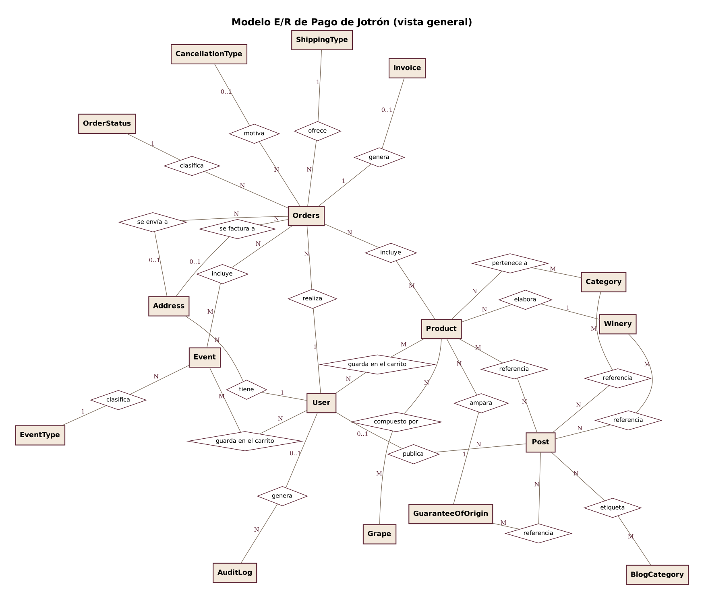
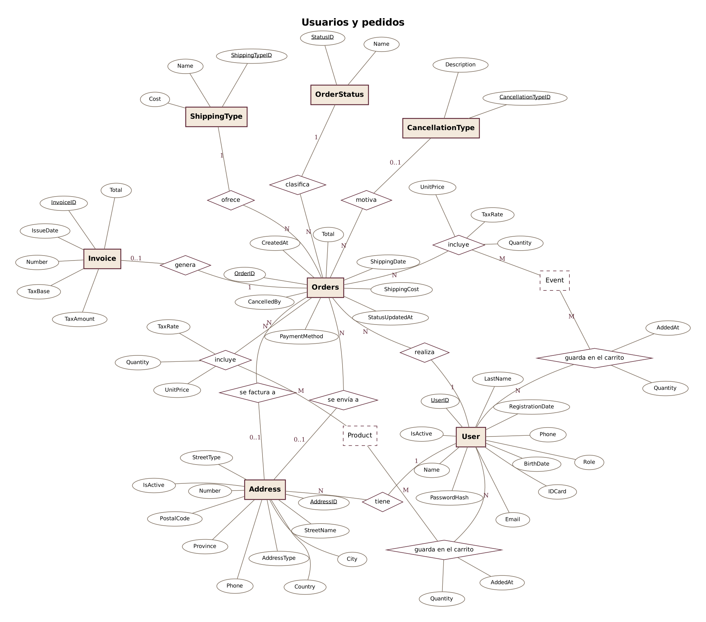
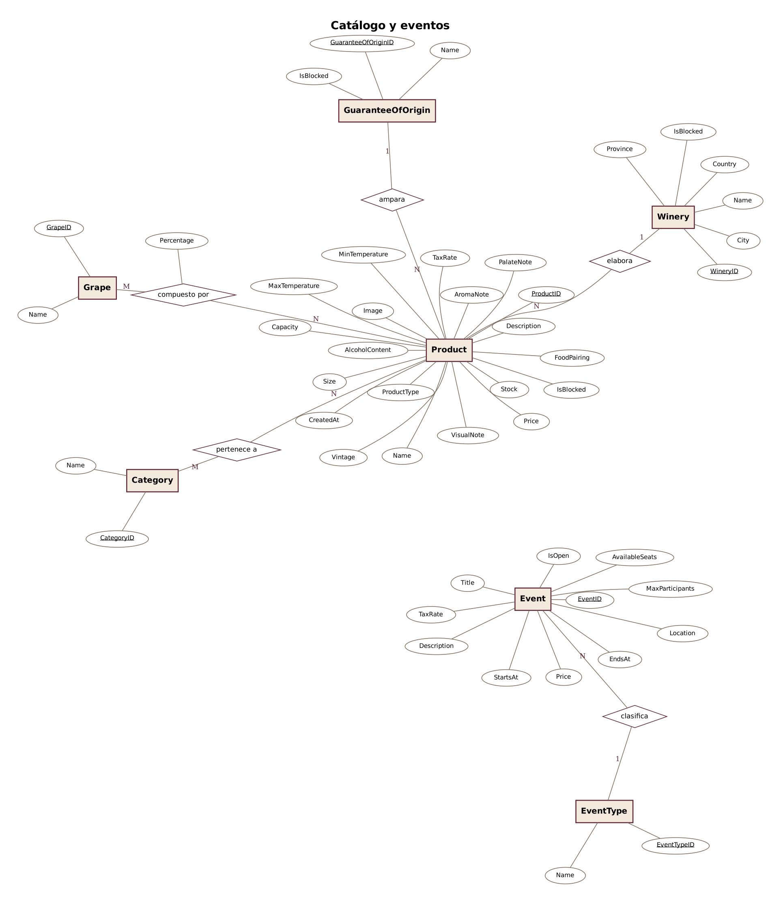
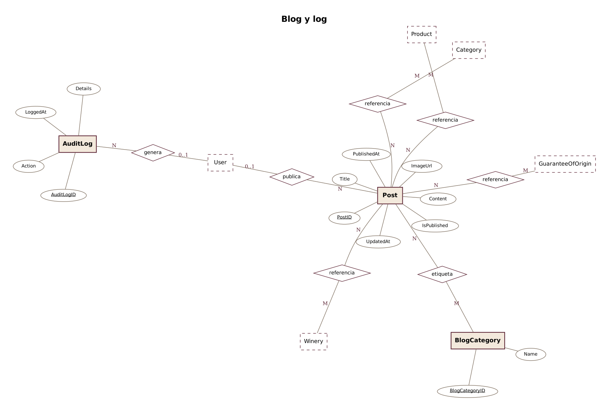
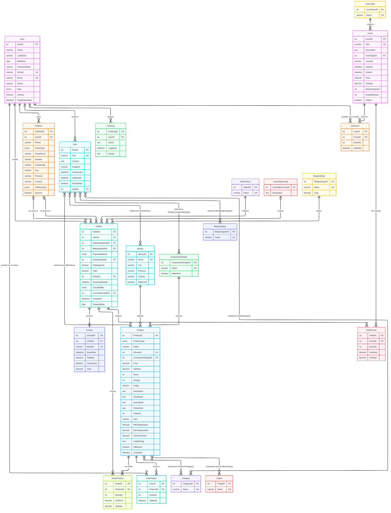

# Diseño de la base de datos — E-commerce "Pago de Jotrón"

En este documento desarrollo el apartado 5 del enunciado: el modelo Entidad/Relación, su paso al modelo relacional, los tipos de datos de cada campo y los scripts de la base de datos. Uso **MariaDB**, que es el gestor que ya usa el proyecto (Next.js 14 + Drizzle ORM). Los nombres de tabla y columna van en inglés; los valores del dominio (estados, tipos de envío, nombres de producto) se quedan en español.

## 1. Modelo Entidad/Relación

### 1.1. Diagrama E/R clásico

El enunciado pide el diagrama clásico, con las entidades y las relaciones separadas. Uso la notación de **Chen**:

- Las **entidades** son rectángulos y las **relaciones**, rombos con su nombre.
- Los **atributos** son óvalos. La **clave primaria** va subrayada.
- La **cardinalidad** (1, 0..1, N, M) va en cada extremo de la relación.
- Las relaciones N:M que tienen datos propios llevan sus atributos colgando del rombo (por ejemplo, `Quantity` y `UnitPrice` en "incluye").

Las claves externas no se dibujan en este diagrama, porque en el modelo E/R las representa la propia relación. Aparecen en el paso a tablas (apartado 2).

Con 18 entidades y más de 150 atributos, un único diagrama no se puede leer. Por eso lo divido en una vista general y tres diagramas por área, con todos los atributos.

**Vista general** (entidades, relaciones y cardinalidades):



**Usuarios y pedidos.** `Product` y `Event` aparecen con borde discontinuo porque sus atributos están en el diagrama del catálogo:



**Catálogo y eventos:**



**Blog y log de acciones:**



Los diagramas están hechos con **Graphviz**. Las fuentes son los ficheros `.dot` de la carpeta `imagenes/`.

### 1.2. Diagrama con atributos, tipos y claves

Como apoyo al paso a tablas, este diagrama muestra cada tabla con sus tipos y sus claves (PK, FK y UK). Está hecho con **Mermaid**; la fuente es `imagenes/bbdd-er.mmd`.



## 2. Paso al modelo relacional

Convierto cada entidad en una tabla y cada relación N:M en una tabla de relación, normalizando hasta la **tercera forma normal**. Las relaciones 1:N se quedan como clave externa en el lado N. Marco las claves primarias con **(PK)** y las externas con **(FK)**:

- `User (UserID PK, Name, LastName, BirthDate, PasswordHash, IDCard, Email, Phone, Role, IsActive, RegistrationDate)`
- `Address (AddressID PK, UserID FK → User, Phone, StreetType, StreetName, Number, PostalCode, City, Province, Country, AddressType, IsActive)`
- `Winery (WineryID PK, Name, City, Province, Country, IsBlocked)`
- `GuaranteeOfOrigin (GuaranteeOfOriginID PK, Name, IsBlocked)`
- `Product (ProductID PK, ProductType, Name, WineryID FK → Winery, GuaranteeOfOriginID FK → GuaranteeOfOrigin, Price, TaxRate, Stock, Vintage, Image, Description, VisualNote, AromaNote, PalateNote, Capacity, Size, MinTemperature, MaxTemperature, AlcoholContent, FoodPairing, IsBlocked, CreatedAt)`
- `Category (CategoryID PK, Name)`
- `Grape (GrapeID PK, Name)`
- `EventType (EventTypeID PK, Name)`
- `Event (EventID PK, Title, Description, EventTypeID FK → EventType, Location, StartsAt, EndsAt, Price, TaxRate, MaxParticipants, AvailableSeats, IsOpen)`
- `OrderStatus (StatusID PK, Name)`
- `CancellationType (CancellationTypeID PK, Description)`
- `ShippingType (ShippingTypeID PK, Name, Cost)`
- `Orders (OrderID PK, UserID FK → User, ShippingAddressID FK → Address, BillingAddressID FK → Address, PaymentMethod, ShippingTypeID FK → ShippingType, ShippingCost, Total, StatusID FK → OrderStatus, StatusUpdatedAt, CancelledBy, CancellationTypeID FK → CancellationType, CreatedAt, ShippingDate)`
- `Invoice (InvoiceID PK, OrderID FK → Orders (UNIQUE), Number, IssueDate, TaxBase, TaxAmount, Total)`
- `Post (PostID PK, Title, Content, ImageUrl, PublishedAt, UpdatedAt, IsPublished, UserID FK → User)`
- `BlogCategory (BlogCategoryID PK, Name)`
- `AuditLog (AuditLogID PK, UserID FK → User, Action, LoggedAt, Details)`

### Tablas de relación (resultado de relaciones N:M)

- `ProductCategory (ProductID PK/FK → Product, CategoryID PK/FK → Category)`
- `ProductGrape (ProductID PK/FK → Product, GrapeID PK/FK → Grape, Percentage)`
- `OrderProduct (OrderID PK/FK → Orders, ProductID PK/FK → Product, Quantity, UnitPrice, TaxRate)`
- `OrderEvent (OrderID PK/FK → Orders, EventID PK/FK → Event, Quantity, UnitPrice, TaxRate)`
- `CartProduct (UserID PK/FK → User, ProductID PK/FK → Product, Quantity, AddedAt)`
- `CartEvent (UserID PK/FK → User, EventID PK/FK → Event, Quantity, AddedAt)`
- `PostBlogCategory (PostID PK/FK → Post, BlogCategoryID PK/FK → BlogCategory)`
- `PostProduct (PostID PK/FK → Post, ProductID PK/FK → Product)`
- `PostWinery (PostID PK/FK → Post, WineryID PK/FK → Winery)`
- `PostGuaranteeOfOrigin (PostID PK/FK → Post, GuaranteeOfOriginID PK/FK → GuaranteeOfOrigin)`
- `PostCategory (PostID PK/FK → Post, CategoryID PK/FK → Category)`

## 3. Diseño lógico y tipos de datos

Para cada campo indico el tipo de dato que le va mejor en MariaDB, si forma parte de alguna clave y para qué sirve.

### 3.1. User y Address

| Tabla   | Campo            | Tipo                 | Clave     | Descripción                                                                  |
| ------- | ---------------- | -------------------- | --------- | ---------------------------------------------------------------------------- |
| User    | UserID           | `INT AUTO_INCREMENT` | PK        | Identificador único del usuario                                              |
|         | Name             | `VARCHAR(100)`       |           | Nombre                                                                       |
|         | LastName         | `VARCHAR(100)`       |           | Apellidos                                                                    |
|         | BirthDate        | `DATE`               |           | Fecha de nacimiento. Con ella se comprueba la mayoría de edad (RF2)          |
|         | PasswordHash     | `VARCHAR(255)`       |           | Hash bcrypt de la contraseña (60 caracteres, margen para futuros algoritmos) |
|         | IDCard           | `VARCHAR(20)`        | UNIQUE    | NIF/NIE                                                                      |
|         | Email            | `VARCHAR(100)`       | UNIQUE    | Correo de inicio de sesión                                                   |
|         | Phone            | `VARCHAR(20)`        |           | Teléfono de contacto                                                         |
|         | Role             | `ENUM`               |           | Cliente, Editor o Administrador                                              |
|         | IsActive         | `BOOLEAN`            |           | False = cuenta dada de baja o desactivada                                    |
|         | RegistrationDate | `DATETIME`           |           | Fecha de alta                                                                |
| Address | AddressID        | `INT AUTO_INCREMENT` | PK        | Identificador de la dirección                                                |
|         | UserID           | `INT`                | FK → User | Usuario al que pertenece la dirección                                        |
|         | Phone            | `VARCHAR(20)`        |           | Teléfono de contacto para la entrega                                         |
|         | StreetType       | `ENUM`               |           | Tipos de vía de España: Calle, Avenida, Plaza, Paseo, Camino, Carretera, Ronda, Travesía, Glorieta, Urbanización |
|         | StreetName       | `VARCHAR(100)`       |           | Nombre de la vía                                                             |
|         | Number           | `VARCHAR(10)`        |           | Número o "s/n"                                                               |
|         | PostalCode       | `VARCHAR(10)`        |           | Código postal (texto, para no perder el 0 inicial de "07014")                |
|         | City             | `VARCHAR(100)`       |           | Localidad                                                                    |
|         | Province         | `VARCHAR(100)`       |           | Provincia                                                                    |
|         | Country          | `VARCHAR(100)`       |           | País, por defecto España                                                     |
|         | AddressType      | `ENUM`               |           | Envío o Facturación                                                          |
|         | IsActive         | `BOOLEAN`            |           | False = el cliente la ha quitado, pero se conserva por sus pedidos           |

### 3.2. Catálogo: Product, Category, GuaranteeOfOrigin, Winery y Grape

| Tabla             | Campo               | Tipo                 | Clave                  | Descripción                                                                  |
| ----------------- | ------------------- | -------------------- | ---------------------- | ---------------------------------------------------------------------------- |
| Product           | ProductID           | `INT AUTO_INCREMENT` | PK                     | Identificador del producto                                                   |
|                   | ProductType         | `ENUM`               |                        | Vino o Pasas (RF4)                                                           |
|                   | Name                | `VARCHAR(100)`       |                        | Nombre comercial                                                             |
|                   | WineryID            | `INT`                | FK → Winery            | Bodega que lo elabora                                                        |
|                   | GuaranteeOfOriginID | `INT`                | FK → GuaranteeOfOrigin | Denominación de origen del vino o de las pasas                               |
|                   | Price               | `DECIMAL(10,2)`      |                        | Precio en euros con IVA incluido. `CHECK (Price >= 0)`                       |
|                   | TaxRate             | `DECIMAL(5,2)`       |                        | Tipo de IVA: 21 % el vino, 10 % las pasas. `CHECK` con los tipos legales     |
|                   | Stock               | `INT`                |                        | Unidades disponibles. `CHECK (Stock >= 0)`                                   |
|                   | Vintage             | `INT`                |                        | Año de cosecha. NULL en los vinos de solera, que no tienen añada             |
|                   | Image               | `VARCHAR(255)`       |                        | Ruta o URL de la imagen                                                      |
|                   | Description         | `TEXT`               |                        | Descripción general                                                          |
|                   | VisualNote          | `TEXT`               |                        | Nota de cata (vista)                                                         |
|                   | AromaNote           | `TEXT`               |                        | Nota de cata (nariz)                                                         |
|                   | PalateNote          | `TEXT`               |                        | Nota de cata (boca)                                                          |
|                   | Capacity            | `INT`                |                        | Capacidad en mililitros (solo vinos)                                         |
|                   | Size                | `VARCHAR(50)`        |                        | Presentación en texto ("75 cl", "37,5 cl", "500 g", "1 kg")                  |
|                   | MinTemperature      | `DECIMAL(5,2)`       |                        | Temperatura de servicio mínima                                               |
|                   | MaxTemperature      | `DECIMAL(5,2)`       |                        | Temperatura de servicio máxima                                               |
|                   | AlcoholContent      | `DECIMAL(5,2)`       |                        | Grado alcohólico en volumen                                                  |
|                   | FoodPairing         | `TEXT`               |                        | Recomendaciones de maridaje                                                  |
|                   | IsBlocked           | `BOOLEAN`            |                        | True = venta bloqueada                                                       |
|                   | CreatedAt           | `DATETIME`           |                        | Fecha de alta del producto                                                   |
| Category          | CategoryID          | `INT AUTO_INCREMENT` | PK                     | Identificador de la tipología                                                |
|                   | Name                | `VARCHAR(100)`       | UNIQUE                 | Tipología del vino (Fino, Manzanilla, Tinto roble…)                          |
| GuaranteeOfOrigin | GuaranteeOfOriginID | `INT AUTO_INCREMENT` | PK                     | Identificador de la D.O.                                                     |
|                   | Name                | `VARCHAR(100)`       | UNIQUE                 | Nombre de la denominación                                                    |
|                   | IsBlocked           | `BOOLEAN`            |                        | True = venta bloqueada para todos sus productos                              |
| Winery            | WineryID            | `INT AUTO_INCREMENT` | PK                     | Identificador de la bodega                                                   |
|                   | Name                | `VARCHAR(100)`       | UNIQUE                 | Nombre de la bodega                                                          |
|                   | City                | `VARCHAR(100)`       |                        | Localidad                                                                    |
|                   | Province            | `VARCHAR(100)`       |                        | Provincia                                                                    |
|                   | Country             | `VARCHAR(100)`       |                        | País                                                                         |
|                   | IsBlocked           | `BOOLEAN`            |                        | True = venta bloqueada para todos sus productos                              |
| Grape             | GrapeID             | `INT AUTO_INCREMENT` | PK                     | Identificador de la variedad de uva                                          |
|                   | Name                | `VARCHAR(100)`       | UNIQUE                 | Nombre de la variedad                                                        |

### 3.3. Eventos, pedidos, facturas y contenido

| Tabla            | Campo              | Tipo                 | Clave                 | Descripción                                                                         |
| ---------------- | ------------------ | -------------------- | --------------------- | ----------------------------------------------------------------------------------- |
| EventType        | EventTypeID        | `INT AUTO_INCREMENT` | PK                    | Identificador del tipo de evento                                                    |
|                  | Name               | `VARCHAR(100)`       | UNIQUE                | Visita guiada, Cata guiada, Cata maridada, Vendimia, Taller                         |
| Event            | EventID            | `INT AUTO_INCREMENT` | PK                    | Identificador del evento                                                            |
|                  | Title              | `VARCHAR(100)`       | UNIQUE                | Título del evento                                                                   |
|                  | Description        | `TEXT`               |                       | Descripción y programa                                                              |
|                  | EventTypeID        | `INT`                | FK → EventType        | Tipo de evento                                                                      |
|                  | Location           | `VARCHAR(150)`       |                       | Lugar. Por defecto, "Bodega Pago de Jotrón" (RF4)                                   |
|                  | StartsAt           | `DATETIME`           |                       | Fecha y hora de inicio                                                              |
|                  | EndsAt             | `DATETIME`           |                       | Fecha y hora de fin. `CHECK (EndsAt > StartsAt)`                                    |
|                  | Price              | `DECIMAL(10,2)`      |                       | Precio por entrada, con IVA                                                         |
|                  | TaxRate            | `DECIMAL(5,2)`       |                       | Tipo de IVA del evento, 21 %                                                        |
|                  | MaxParticipants    | `INT`                |                       | Aforo máximo                                                                        |
|                  | AvailableSeats     | `INT`                |                       | Plazas libres, que hacen de stock. `CHECK (AvailableSeats BETWEEN 0 AND MaxParticipants)` |
|                  | IsOpen             | `BOOLEAN`            |                       | True = abierto a inscripciones                                                      |
| OrderStatus      | StatusID           | `INT AUTO_INCREMENT` | PK                    | Identificador del estado                                                            |
|                  | Name               | `VARCHAR(50)`        | UNIQUE                | Los ocho estados del RF8, de Pendiente de pago a Bloqueado                          |
| CancellationType | CancellationTypeID | `INT AUTO_INCREMENT` | PK                    | Identificador del motivo de anulación                                               |
|                  | Description        | `TEXT`               |                       | Motivo de la anulación                                                              |
| ShippingType     | ShippingTypeID     | `INT AUTO_INCREMENT` | PK                    | Identificador del tipo de envío                                                     |
|                  | Name               | `VARCHAR(50)`        | UNIQUE                | Envío estándar, exprés, a Baleares, recogida en bodega o sin envío                  |
|                  | Cost               | `DECIMAL(10,2)`      |                       | Coste actual del envío en euros                                                     |
| Orders           | OrderID            | `INT AUTO_INCREMENT` | PK                    | Identificador del pedido                                                            |
|                  | UserID             | `INT`                | FK → User             | Cliente que realiza la compra                                                       |
|                  | ShippingAddressID  | `INT`                | FK → Address          | Dirección de envío. NULL si se recoge en bodega o solo lleva eventos                |
|                  | BillingAddressID   | `INT`                | FK → Address          | Dirección de facturación. NULL si se factura a la de envío                          |
|                  | PaymentMethod      | `ENUM`               |                       | Tarjeta, PayPal o Transferencia (RF7)                                               |
|                  | ShippingTypeID     | `INT`                | FK → ShippingType     | Tipo de envío elegido en el checkout                                                |
|                  | ShippingCost       | `DECIMAL(10,2)`      |                       | Coste del envío en el momento de la compra                                          |
|                  | Total              | `DECIMAL(10,2)`      |                       | Importe total con IVA                                                               |
|                  | StatusID           | `INT`                | FK → OrderStatus      | Estado actual                                                                       |
|                  | StatusUpdatedAt    | `DATETIME`           |                       | Último cambio de estado. Sirve para la regla de los 15 días (RF8)                   |
|                  | CancelledBy        | `ENUM`               |                       | Cliente o Administrador, si el pedido está anulado                                  |
|                  | CancellationTypeID | `INT`                | FK → CancellationType | Motivo, si está anulado                                                             |
|                  | CreatedAt          | `DATETIME`           |                       | Fecha de creación. Sirve para la cancelación en 24 horas (RF8)                      |
|                  | ShippingDate       | `DATE`               |                       | Fecha de envío. NULL hasta que el pedido sale de la bodega                          |
| Invoice          | InvoiceID          | `INT AUTO_INCREMENT` | PK                    | Identificador de la factura                                                         |
|                  | OrderID            | `INT`                | FK → Orders (UNIQUE)  | Pedido facturado                                                                    |
|                  | Number             | `VARCHAR(50)`        | UNIQUE                | Número correlativo (FAC-2026-0001)                                                  |
|                  | IssueDate          | `DATETIME`           |                       | Fecha de emisión                                                                    |
|                  | TaxBase            | `DECIMAL(10,2)`      |                       | Base imponible: suma de cada línea sin IVA, según su tipo                           |
|                  | TaxAmount          | `DECIMAL(10,2)`      |                       | Cuota de IVA total                                                                  |
|                  | Total              | `DECIMAL(10,2)`      |                       | Importe facturado. `CHECK (Total = TaxBase + TaxAmount)`                            |
| Post             | PostID             | `INT AUTO_INCREMENT` | PK                    | Identificador de la entrada de blog                                                 |
|                  | Title              | `VARCHAR(100)`       | UNIQUE                | Título de la entrada                                                                |
|                  | Content            | `TEXT`               |                       | Cuerpo de la entrada                                                                |
|                  | ImageUrl           | `VARCHAR(255)`       |                       | Imagen destacada (opcional)                                                         |
|                  | PublishedAt        | `DATETIME`           |                       | Fecha de publicación. NULL en los borradores                                        |
|                  | UpdatedAt          | `DATETIME`           |                       | Fecha de última modificación                                                        |
|                  | IsPublished        | `BOOLEAN`            |                       | True = publicada                                                                    |
|                  | UserID             | `INT`                | FK → User             | Autor (editor o administrador)                                                      |
| BlogCategory     | BlogCategoryID     | `INT AUTO_INCREMENT` | PK                    | Identificador de la categoría de blog                                               |
|                  | Name               | `VARCHAR(100)`       | UNIQUE                | Nombre de la categoría                                                              |
| AuditLog         | AuditLogID         | `INT AUTO_INCREMENT` | PK                    | Identificador del registro                                                          |
|                  | UserID             | `INT`                | FK → User             | Usuario que hizo la acción. NULL si la hizo una tarea automática                    |
|                  | Action             | `TEXT`               |                       | Acción registrada                                                                   |
|                  | LoggedAt           | `DATETIME`           |                       | Fecha del registro                                                                  |
|                  | Details            | `TEXT`               |                       | Información adicional                                                               |

### 3.4. Tablas de relación

| Tabla                 | Campos (clave compuesta)                | Atributo extra                                     | Semántica                                 |
| --------------------- | --------------------------------------- | -------------------------------------------------- | ----------------------------------------- |
| ProductCategory       | ProductID PK/FK, CategoryID PK/FK       | —                                                  | Producto ↔ Tipologías                     |
| ProductGrape          | ProductID PK/FK, GrapeID PK/FK          | Percentage `DECIMAL(5,2)`                          | Producto ↔ Uvas con el porcentaje del coupage |
| OrderProduct          | OrderID PK/FK, ProductID PK/FK          | Quantity `INT UNSIGNED`, UnitPrice `DECIMAL(10,2)`, TaxRate `DECIMAL(5,2)` | Líneas de producto del pedido |
| OrderEvent            | OrderID PK/FK, EventID PK/FK            | Quantity `INT UNSIGNED`, UnitPrice `DECIMAL(10,2)`, TaxRate `DECIMAL(5,2)` | Entradas de eventos del pedido |
| CartProduct           | UserID PK/FK, ProductID PK/FK           | Quantity `INT UNSIGNED`, AddedAt `DATETIME`        | Carrito guardado: productos               |
| CartEvent             | UserID PK/FK, EventID PK/FK             | Quantity `INT UNSIGNED`, AddedAt `DATETIME`        | Carrito guardado: entradas de eventos     |
| PostBlogCategory      | PostID PK/FK, BlogCategoryID PK/FK      | —                                                  | Entrada ↔ Categorías de blog              |
| PostProduct           | PostID PK/FK, ProductID PK/FK           | —                                                  | Entrada ↔ Productos citados               |
| PostWinery            | PostID PK/FK, WineryID PK/FK            | —                                                  | Entrada ↔ Bodegas citadas                 |
| PostGuaranteeOfOrigin | PostID PK/FK, GuaranteeOfOriginID PK/FK | —                                                  | Entrada ↔ D.O. citadas                    |
| PostCategory          | PostID PK/FK, CategoryID PK/FK          | —                                                  | Entrada ↔ Tipologías citadas              |

## 4. Aclaraciones sobre el diseño

**Por qué hay 28 tablas y no más.** En una primera versión me salieron 38, porque convertí en tabla de relación todas las relaciones que parecían N:M. Al repasarlas una a una contra los requisitos vi que varias no lo eran de verdad, así que las cambié por una clave externa o por un campo dentro de la propia tabla:

| Lo que quité                              | Por qué                                                          | Qué puse en su lugar                |
| ----------------------------------------- | ---------------------------------------------------------------- | ----------------------------------- |
| `Role` + `UserRole`                       | Un usuario tiene un solo rol, nunca varios a la vez              | `User.Role` como ENUM               |
| `UserAddress`                             | Una dirección no se comparte entre usuarios                      | `Address.UserID`                    |
| `WineWinery`                              | Cada producto lo hace una sola bodega                            | `Product.WineryID`                  |
| `WineryGuaranteeOfOrigin`                 | Las D.O. de una bodega salen de sus productos                    | `Product.GuaranteeOfOriginID`       |
| `UserEvent`                               | La visita o cata se compra como producto, ya queda en el pedido  | Nada, sobraba                       |
| `StaticPage`                              | Las páginas informativas y legales son estáticas (RF11)          | Páginas fijas en el código          |
| `Media` + `PostMedia` + `StaticPageMedia` | El blog no usa más de una imagen por artículo                    | `ImageUrl` en `Post`                |

También quité las tres tablas de preferencias del usuario y el campo `AgeVerified`: la mayoría de edad se calcula con `BirthDate`, así que guardarla aparte era un dato redundante.

El resto de decisiones:

- **Una sola tabla de productos.** La tabla se llama `Product` y no `Wine` porque también guarda las pasas. `ProductType` distingue vinos y pasas (RF4). Los campos propios del vino (notas de cata, temperaturas, graduación) quedan a NULL en las pasas.
- **Presentaciones.** Cada formato es una fila distinta con su precio y su stock (RF4). `Size` guarda el formato en texto ("75 cl", "500 g") y `Capacity`, los mililitros de los vinos.
- **Bodega y denominación de origen.** Cada producto pertenece a una sola bodega y a una sola D.O., así que las dos van como clave externa en `Product`. Una bodega puede trabajar con varias D.O.; no lo guardo en `Winery`, lo saco de sus productos.
- **Bloqueo de venta.** `Product`, `Winery` y `GuaranteeOfOrigin` tienen su propio `IsBlocked`. Un producto se vende solo si ninguno de los tres está bloqueado. Así, al bloquear una bodega o una D.O. no hay que tocar sus productos uno a uno, y un vino no se puede desbloquear por separado mientras su bodega o su D.O. sigan bloqueadas (RF4).
- **Eventos.** Solo los organiza Pago de Jotrón, así que `Event` no necesita una clave externa a `Winery`. En su lugar guarda `Location`, con la bodega como valor por defecto, y la hora de inicio y de fin que pide el RF4. Las plazas libres (`AvailableSeats`) hacen de stock.
- **Líneas y total del pedido.** `OrderProduct` y `OrderEvent` guardan la cantidad y el precio al que se compró cada cosa, y `Orders.ShippingCost`, lo que costó el envío. El catálogo y las tarifas pueden cambiar después, pero el pedido no. El `Total` es la suma de las líneas más el envío.
- **Carrito entre dispositivos.** `CartProduct` y `CartEvent` guardan el carrito del cliente con sesión iniciada, así lo recupera en el móvil o en el ordenador (RF6). El visitante sin sesión lo tiene en el navegador y, al entrar, se fusiona con el guardado. La clave compuesta impide repetir un producto: si lo añade otra vez, sube la cantidad. Al confirmar el pedido, la aplicación vacía el carrito en la misma transacción.
- **Direcciones del pedido.** `Orders` apunta a la dirección de envío y a la de facturación. Si el cliente quita una dirección que ya se usó, no se borra: se marca con `IsActive = FALSE`, porque la factura la necesita.
- **Estados del pedido.** `OrderStatus` recoge los ocho estados del RF8, incluido **Pendiente de pago** para las transferencias. `StatusUpdatedAt` permite saber cuándo un pedido lleva 15 días en el mismo estado. `CancelledBy` guarda si anuló el cliente o el administrador y `CancellationType`, el motivo.
- **Factura.** `Invoice` va 1:1 con un pedido entregado (RF8). Guarda la base imponible y la cuota de IVA para poder descargarla sin recalcularla.
- **IVA por tipo de producto.** Los precios de la tienda llevan el IVA incluido, pero no todo paga lo mismo: el vino y los eventos van al 21 % y las pasas, que son un alimento, al 10 %. Por eso `Product` y `Event` tienen su `TaxRate`, y cada línea del pedido copia el tipo que se aplicó, igual que hace con el precio. Si el tipo cambia por ley, las facturas antiguas no se mueven. La factura suma la base de cada línea y la del envío (al 21 %).
- **Borrados.** Las claves que apuntan al historial usan `ON DELETE RESTRICT`: no se puede borrar un producto, un evento, una bodega o una D.O. que ya tiene pedidos o productos asociados, ni un pedido con factura. Para retirar algo de la tienda está `IsBlocked` (RF4: "la baja retira el producto pero no lo borra"). Las tablas de relación del catálogo y del blog sí borran en cascada, porque solo son etiquetas.
- **Restricciones `CHECK`.** Protegen las reglas que no dependen de la aplicación: stock, precios y plazas nunca negativos, cantidades mayores que cero, tipos de IVA válidos (4, 10 o 21 %), porcentajes de uva entre 0 y 100, fechas de evento coherentes y total de factura igual a base más IVA.
- **Tipos de datos.** Los precios son `DECIMAL(10,2)` en euros: con `DECIMAL` no hay errores de redondeo como con `FLOAT`. Las cantidades son `INT UNSIGNED`, porque no se pueden comprar 1,5 botellas. La base de datos va en `utf8mb4` para que las tildes y la ñ salgan bien.
- **Contraseñas.** Cada usuario de prueba tiene el hash bcrypt de la misma contraseña (`Password123!`), para poder entrar con cualquiera de ellos.

## 5. Scripts de la base de datos

Hay tres ficheros. Primero se ejecuta el de creación y después **uno** de los dos de datos:

1. **`crear-bbdd.sql`**: borra la base de datos si existe y crea `Jotron` con sus 28 tablas, claves y restricciones.
2. **`datos-bbdd.sql`**: la **versión entregable**. Inserta entre 5 y 10 registros por tabla (12 en `Orders` y `OrderProduct`, para cubrir los ocho estados del pedido) y crea los usuarios, roles y privilegios de MariaDB.
3. **`datos-bbdd-ampliado.sql`**: la **versión ampliada**. Tiene los mismos datos que la entregable y añade más bodegas, productos, clientes y pedidos para probar la aplicación con un catálogo más real. También crea los usuarios y roles.

```bash
mariadb -u root -p < crear-bbdd.sql
mariadb -u root -p < datos-bbdd.sql        # o datos-bbdd-ampliado.sql
```

Los he probado sobre **MariaDB 10.11**. Se pueden lanzar varias veces seguidas: el de creación empieza de cero y los usuarios y roles se crean con `IF NOT EXISTS`.

### 5.1. Usuarios, roles y privilegios

La aplicación no se conecta como `root`. Cada uso tiene su usuario de MariaDB con un rol que solo da los permisos necesarios (principio de **mínimo privilegio**):

| Rol            | Usuario           | Contraseña              | Privilegios                                                                                     | Para qué                                     |
| -------------- | ----------------- | ----------------------- | ----------------------------------------------------------------------------------------------- | -------------------------------------------- |
| `rol_tienda`   | `jotron_app`      | `App_Jotron_2026!`      | `SELECT`, `INSERT`, `UPDATE` en todas las tablas; `DELETE` solo en direcciones, carrito y tablas de relación del catálogo y del blog | La aplicación web                            |
| `rol_informes` | `jotron_informes` | `Informes_Jotron_2026!` | `SELECT`                                                                                        | Informes de ventas y estadísticas            |
| `rol_copias`   | `jotron_copias`   | `Copias_Jotron_2026!`   | `SELECT`, `LOCK TABLES`, `SHOW VIEW`, `EVENT`, `TRIGGER`                                         | Copias de seguridad con `mariadb-dump`       |
| `rol_admin_bd` | `jotron_admin`    | `Admin_Jotron_2026!`    | `ALL PRIVILEGES` sobre `Jotron`                                                                 | Mantenimiento y migraciones                  |

La clave está en `rol_tienda`: la aplicación **no puede borrar** pedidos, facturas, productos, usuarios ni el log de acciones. Si alguien encontrara un fallo en la web, no podría borrar el historial. Lo he comprobado entrando como `jotron_app`:

```text
DELETE FROM Orders WHERE OrderID = 10;
ERROR 1142 (42000): DELETE command denied to user 'jotron_app'@'localhost' for table `Jotron`.`Orders`
```

Estos roles de MariaDB son distintos de los roles de la aplicación (`User.Role`: Cliente, Editor y Administrador), que se comprueban en el servidor de Next.js (RNF3). Los usuarios de la aplicación (tabla `User`) entran todos con la contraseña `Password123!`. Las contraseñas del script son de ejemplo; en producción se cambian y se guardan en variables de entorno.

### 5.2. Datos de prueba

Los datos cuentan una historia coherente a fecha de **6 de octubre de 2026**:

- **Usuarios:** un administrador, dos editores y siete clientes, todos mayores de edad y con DNI válidos.
- **Catálogo:** solo vinos de Andalucía, de bodegas y denominaciones reales. Las pasas son siempre de Pago de Jotrón y de la **DOP Pasas de Málaga**, en dos presentaciones. Bodegas Toro Albalá está bloqueada, y el log recoge quién la bloqueó y cuándo.
- **Eventos:** todos en Pago de Jotrón. La vendimia de septiembre ya se ha celebrado y está cerrada; el resto son de otoño e invierno.
- **Pedidos:** cubren los ocho estados del RF8 y los cinco tipos de envío. Para eso `Orders` y `OrderProduct` llegan a 12 filas: `Invoice` necesita al menos 5 pedidos entregados y los otros siete estados llevan uno cada uno. Los entregados tienen su factura, con numeración correlativa por fecha. El pedido de transferencia que lleva más de 15 días sin pagarse está **Bloqueado**, y el pedido **En proceso** es de las últimas 24 horas, así que el cliente aún puede cancelarlo.
- **Carritos:** varios clientes tienen productos y entradas guardados sin comprar, siempre de productos a la venta y eventos abiertos.
- **Contenido:** entradas de blog escritas por los editores, con un borrador sin publicar.

| Tabla                 | Entregable | Ampliada |
| --------------------- | ---------: | -------: |
| User                  | 10 | 20 |
| Address               | 10 | 21 |
| Winery                | 10 | 31 |
| GuaranteeOfOrigin     | 10 | 20 |
| Product               | 9  | 26 |
| Category              | 10 | 18 |
| Grape                 | 10 | 30 |
| EventType             | 5  | 6  |
| Event                 | 5  | 9  |
| OrderStatus           | 8  | 8  |
| CancellationType      | 5  | 5  |
| ShippingType          | 5  | 5  |
| Orders                | 12 | 27 |
| Invoice               | 5  | 14 |
| Post                  | 10 | 14 |
| BlogCategory          | 10 | 10 |
| AuditLog              | 8  | 16 |
| ProductCategory       | 7  | 23 |
| ProductGrape          | 10 | 32 |
| OrderProduct          | 12 | 35 |
| OrderEvent            | 5  | 11 |
| CartProduct           | 9  | 13 |
| CartEvent             | 5  | 8  |
| PostBlogCategory      | 10 | 15 |
| PostProduct           | 10 | 16 |
| PostWinery            | 6  | 10 |
| PostGuaranteeOfOrigin | 6  | 10 |
| PostCategory          | 8  | 10 |

En la versión ampliada salen además los estados **Preparado** y **Enviado**, una anulación hecha por el administrador, una dirección inactiva y un cliente dado de baja.

### 5.3. Cumplimiento de los mínimos del enunciado

| Requisito                                  | Cómo se cumple                                                                                     |
| ------------------------------------------ | -------------------------------------------------------------------------------------------------- |
| Al menos 6 tablas                          | 28 tablas (17 de entidades y 11 de relación)                                                        |
| Relación de unas tablas con otras          | 35 claves externas; solo `Orders` tiene 6                                                          |
| Entre 5 y 10 registros por tabla           | Se cumple en 26 tablas; `Orders` y `OrderProduct` tienen 12 para cubrir los ocho estados                                                     |
| Registros con las dependencias del script  | Todas las claves externas apuntan a filas que existen y los datos cuadran entre sí (totales, facturas, fechas) |
| Usuarios, privilegios y roles              | 4 roles y 4 usuarios de MariaDB en `datos-bbdd.sql`, apartado 5.1                                  |
| Script en un archivo ejecutable            | `crear-bbdd.sql` y `datos-bbdd.sql` se ejecutan directamente con el cliente `mariadb`              |

## 6. Resumen

Con este diseño cubro el apartado 5 del enunciado y dejo la base de datos lista para montar encima el modelo de **Drizzle ORM**. Lo que más me ha costado ha sido decidir cuántas tablas hacían falta de verdad: normalizar todo a la primera me llevó a 38 y, al revisarlo contra los requisitos, se quedó en 26. Después añadí las dos del carrito para que se conserve entre dispositivos y `PostCategory`, para relacionar los artículos del blog con las tipologías de vino (RF10). Por último quité `StaticPage`, porque las páginas informativas pasan a ser estáticas: 28 tablas que puedo justificar una por una. Además, las restricciones `CHECK`, las claves con `RESTRICT` y los roles de MariaDB protegen los datos aunque la aplicación tenga un fallo.
