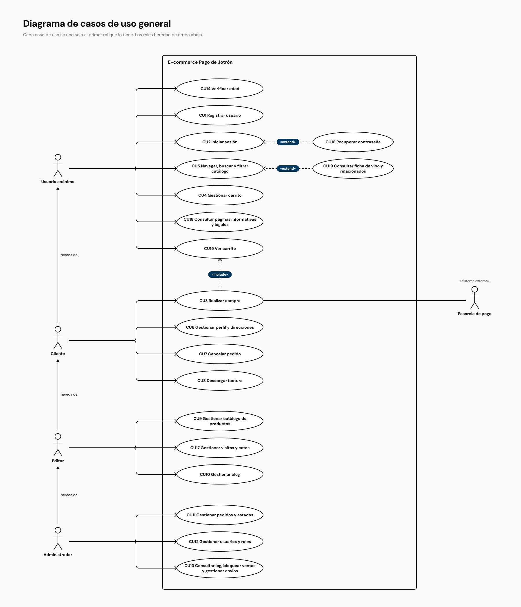
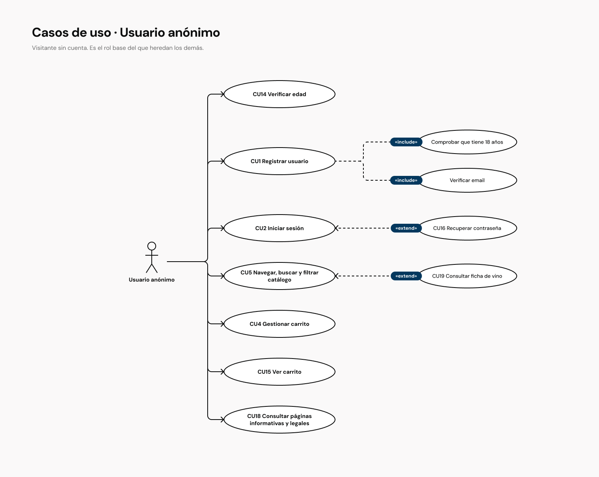
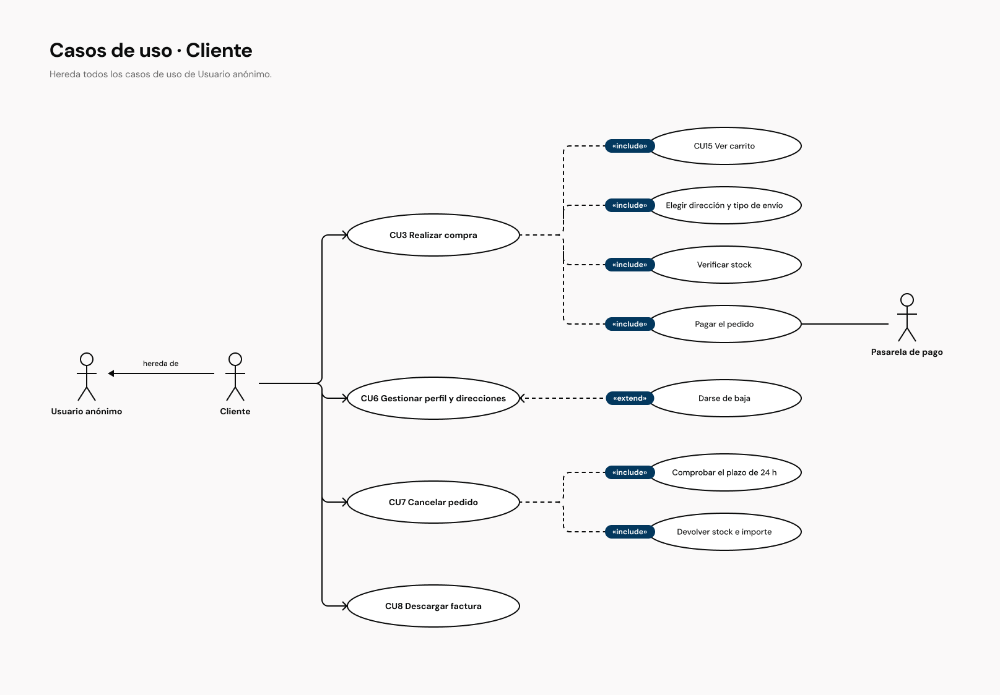
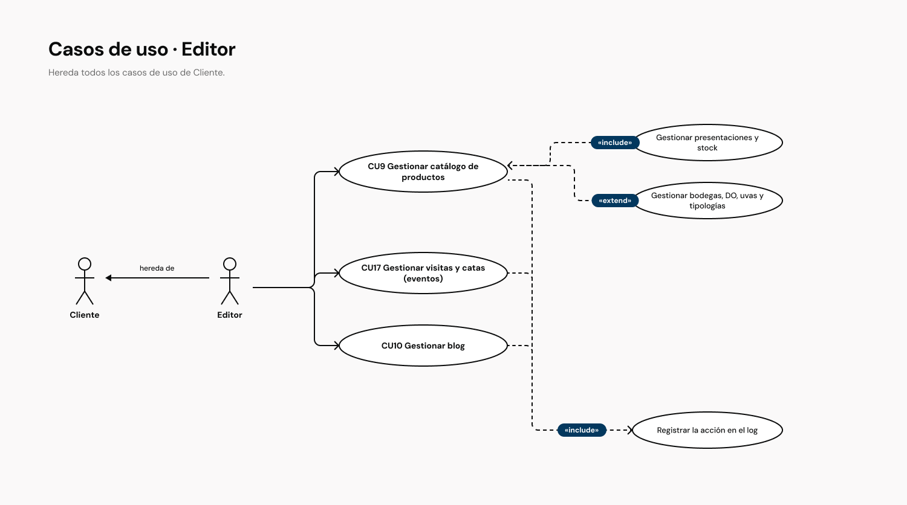
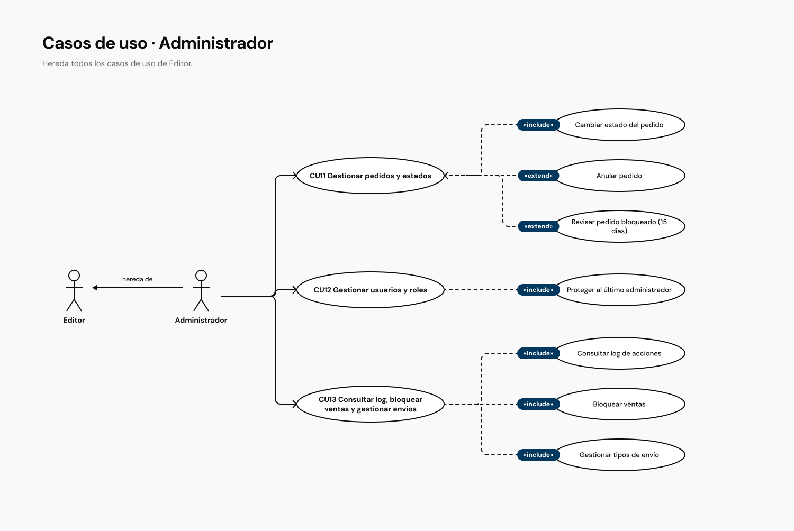

# Casos de uso — E-commerce "Pago de Jotrón"

En este apartado identifico quién usa la tienda y qué puede hacer cada uno. Primero presento los actores y el diagrama general, y después describo en detalle los tres casos de uso principales: los que sostienen la venta y que más reglas de negocio tienen.

## 1. Actores

| Actor                | Rol en el sistema                  | Qué puede hacer                                                                                    |
| -------------------- | ---------------------------------- | -------------------------------------------------------------------------------------------------- |
| **Usuario anónimo**  | Visitante                          | Verificar su edad, navegar por el catálogo, leer las páginas informativas, llenar el carrito, registrarse y entrar. |
| **Cliente**          | Usuario registrado                 | Todo lo del anónimo, y además comprar, cancelar pedidos, descargar facturas y gestionar su perfil. |
| **Editor**           | Empleado de la bodega (gestión)    | Todo lo del cliente, y además gestionar el catálogo, las visitas y catas y el blog.                |
| **Administrador**    | Responsable de la tienda           | Todo lo del editor, y además gestionar pedidos, usuarios y roles, bloqueos de venta, tipos de envío y el log.      |
| **Pasarela de pago** | Actor secundario (sistema externo) | Procesar los pagos con tarjeta y PayPal y devolver el resultado.                                   |

## 2. Diagrama de casos de uso general

**Relaciones del diagrama:**

- **Generalización entre actores:** Cliente hereda de Usuario anónimo, Editor de Cliente y Administrador de Editor. Por eso cada caso de uso se une solo al primer rol que lo tiene.
- **CU3 Realizar compra** `<<include>>` **CU15 Ver carrito**: toda compra empieza revisando el carrito.
- **CU16 Recuperar contraseña** `<<extend>>` **CU2 Iniciar sesión**: solo ocurre si el usuario la ha olvidado.
- **CU19 Consultar ficha de vino** `<<extend>>` **CU5 Navegar catálogo**: ocurre cuando el usuario abre un producto desde los resultados.
- La **pasarela de pago** se asocia al CU3 como actor externo.

### 2.1 Casos de uso por rol

Para ver qué hace cada perfil, separo el diagrama por rol. Cada rol hereda los casos de uso del anterior, así que en cada diagrama solo aparecen los suyos, con sus relaciones «include» y «extend». Los cuatro están en [Figma](https://www.figma.com/design/Q48fEy5Kzr16Tu4rjajUtO/Jotron-26-27?node-id=2233-1306).

| Rol | Lo que añade el diagrama |
| --- | --- |
| **Usuario anónimo** | El registro incluye comprobar los 18 años y verificar el email. Recuperar contraseña extiende el login y la ficha de vino extiende el catálogo. |
| **Cliente** | La compra incluye ver el carrito, elegir dirección y envío, verificar el stock y pagar con la pasarela. Darse de baja extiende el perfil. Cancelar incluye comprobar el plazo de 24 h y devolver stock e importe. |
| **Editor** | El catálogo incluye las presentaciones y el stock, y lo extienden los valores asociados (bodegas, DO, uvas y tipologías). Catálogo, eventos y blog incluyen registrar la acción en el log. |
| **Administrador** | Los pedidos incluyen cambiar el estado y los extienden anular y revisar un pedido bloqueado a los 15 días. Los usuarios incluyen proteger al último administrador. El CU13 incluye el log, el bloqueo de ventas y los tipos de envío. |

## 3. Descripción de los casos de uso principales

Elijo estos tres porque cubren el ciclo completo de un pedido: el cliente compra, puede arrepentirse y el administrador lo lleva hasta la entrega. Uso la plantilla de MADEJA (Junta de Andalucía): la secuencia normal alterna lo que hace el actor y lo que hace el sistema, y cada excepción indica el paso en el que ocurre.

### CU3 Realizar compra

<table>
<tr><th>CU3</th><th colspan="2">Realizar compra</th></tr>
<tr><td><strong>Versión</strong></td><td colspan="2">1.0</td></tr>
<tr><td><strong>Dependencias</strong></td><td colspan="2"><ul><li>RF6 Carrito</li><li>RF7 Compra y pago</li><li>RF8 Pedidos y sus estados</li><li>RNF3 Seguridad (los datos de la tarjeta no pasan por el servidor)</li><li>RNF4 Rendimiento (stock y pedido en la misma transacción)</li></ul></td></tr>
<tr><td><strong>Precondición</strong></td><td colspan="2"><em>El cliente ha iniciado sesión, ha verificado que es mayor de edad y tiene en el carrito al menos un producto con stock.</em></td></tr>
<tr><td><strong>Descripción</strong></td><td colspan="2"><em>El sistema deberá comportarse como se describe en el siguiente caso de uso cuando el cliente quiera pagar los productos de su carrito.</em></td></tr>
<tr><td rowspan="15"><strong>Secuencia normal</strong></td><td><strong>Paso</strong></td><td><strong>Acción</strong></td></tr>
<tr><td>1</td><td>El <em>cliente</em> solicita al sistema finalizar la compra desde el carrito.</td></tr>
<tr><td>1.1</td><td>Se realiza el caso de uso <em>CU15 Ver carrito</em>.</td></tr>
<tr><td>2</td><td>El sistema solicita la dirección de envío y la de facturación.</td></tr>
<tr><td>3</td><td>El <em>cliente</em> elige una dirección guardada o introduce una nueva.</td></tr>
<tr><td>4</td><td>El sistema muestra los tipos de envío disponibles con su coste.</td></tr>
<tr><td>5</td><td>El <em>cliente</em> selecciona el tipo de envío.</td></tr>
<tr><td>6</td><td>El sistema recalcula el total con IVA y solicita el método de pago.</td></tr>
<tr><td>7</td><td>El <em>cliente</em> elige tarjeta, PayPal o transferencia bancaria y confirma la compra.</td></tr>
<tr><td>8</td><td>El sistema comprueba que sigue habiendo stock de todos los productos.</td></tr>
<tr><td>9</td><td>Si el pago es con tarjeta o PayPal, el sistema envía el cobro a la <em>pasarela de pago</em>.</td></tr>
<tr><td>9.1</td><td>La <em>pasarela de pago</em> cobra el importe y devuelve el resultado al sistema.</td></tr>
<tr><td>10</td><td>Si el pago es por transferencia, el sistema muestra los datos de la cuenta bancaria.</td></tr>
<tr><td>11</td><td>El sistema crea el pedido, descuenta el stock en la misma operación y vacía el carrito.</td></tr>
<tr><td>12</td><td>El sistema informa de que el pedido se ha registrado y envía el correo de confirmación.</td></tr>
<tr><td><strong>Postcondición</strong></td><td colspan="2"><em>El pedido queda registrado en estado Confirmado (tarjeta o PayPal) o Pendiente de pago (transferencia), con el stock descontado. La aplicación no guarda los datos de la tarjeta.</em></td></tr>
<tr><td rowspan="13"><strong>Excepciones</strong></td><td><strong>Paso</strong></td><td><strong>Acción</strong></td></tr>
<tr><td>3</td><td><em>La dirección está incompleta o fuera de España.</em></td></tr>
<tr><td>E.1</td><td>El sistema informa del problema y no deja continuar hasta corregirla.</td></tr>
<tr><td>8</td><td><em>Otro cliente se ha llevado la última unidad mientras se hacía la compra.</em></td></tr>
<tr><td>E.1</td><td>El sistema informa de que el producto se ha agotado durante la compra.</td></tr>
<tr><td>E.2</td><td>No se crea el pedido ni se cobra, y el carrito se mantiene.</td></tr>
<tr><td>E.3</td><td>Se cancela el caso de uso.</td></tr>
<tr><td>9.1</td><td><em>La pasarela de pago rechaza el cobro.</em></td></tr>
<tr><td>E.1</td><td>El sistema informa al cliente de que el pago no se ha podido realizar.</td></tr>
<tr><td>E.2</td><td>No se crea el pedido y el carrito se mantiene.</td></tr>
<tr><td>E.3</td><td>Se cancela el caso de uso.</td></tr>
<tr><td>12</td><td><em>Falla el envío del correo de confirmación.</em></td></tr>
<tr><td>E.1</td><td>El pedido se mantiene registrado y el error se guarda en el log de errores.</td></tr>
<tr><td><strong>Comentarios</strong></td><td colspan="2">En el MVP1 solo está disponible el pago con tarjeta; PayPal y la transferencia llegan en el MVP2. La pasarela va en su propio módulo para poder añadir métodos de pago sin tocar el resto (RNF2).</td></tr>
</table>

### CU7 Cancelar pedido

<table>
<tr><th>CU7</th><th colspan="2">Cancelar pedido</th></tr>
<tr><td><strong>Versión</strong></td><td colspan="2">1.0</td></tr>
<tr><td><strong>Dependencias</strong></td><td colspan="2"><ul><li>RF8 Pedidos y sus estados</li><li>RNF3 Seguridad (el plazo se comprueba en el servidor)</li><li>RNF6 Calidad (test unitario de la cancelación en 24 horas)</li></ul></td></tr>
<tr><td><strong>Precondición</strong></td><td colspan="2"><em>El cliente ha iniciado sesión y tiene un pedido en estado Pendiente de pago, o en estado Confirmado o En proceso creado hace menos de 24 horas.</em></td></tr>
<tr><td><strong>Descripción</strong></td><td colspan="2"><em>El sistema deberá comportarse como se describe en el siguiente caso de uso cuando el cliente quiera anular un pedido que todavía no se ha preparado.</em></td></tr>
<tr><td rowspan="10"><strong>Secuencia normal</strong></td><td><strong>Paso</strong></td><td><strong>Acción</strong></td></tr>
<tr><td>1</td><td>El <em>cliente</em> solicita al sistema ver sus pedidos.</td></tr>
<tr><td>2</td><td>El sistema muestra el listado de pedidos del cliente con su estado.</td></tr>
<tr><td>3</td><td>El <em>cliente</em> selecciona el pedido y solicita cancelarlo.</td></tr>
<tr><td>4</td><td>El sistema comprueba que el pedido está Pendiente de pago, o que está Confirmado o En proceso y no han pasado 24 horas desde su creación.</td></tr>
<tr><td>5</td><td>El sistema pide confirmación e informa de que la cancelación no se puede deshacer.</td></tr>
<tr><td>6</td><td>El <em>cliente</em> confirma la cancelación.</td></tr>
<tr><td>7</td><td>El sistema pasa el pedido a Anulado e indica que lo canceló el cliente.</td></tr>
<tr><td>8</td><td>El sistema devuelve las unidades al stock y, si el pedido estaba pagado, el importe al cliente.</td></tr>
<tr><td>9</td><td>El sistema informa de que el pedido se ha cancelado correctamente.</td></tr>
<tr><td><strong>Postcondición</strong></td><td colspan="2"><em>El pedido queda en estado Anulado (por el cliente), con las unidades devueltas al stock y, si estaba pagado, el importe devuelto.</em></td></tr>
<tr><td rowspan="6"><strong>Excepciones</strong></td><td><strong>Paso</strong></td><td><strong>Acción</strong></td></tr>
<tr><td>4</td><td><em>Han pasado más de 24 horas o el pedido ya ha salido del almacén (Preparado, Enviado o Entregado).</em></td></tr>
<tr><td>E.1</td><td>El sistema informa de que el pedido ya no se puede cancelar.</td></tr>
<tr><td>E.2</td><td>Se cancela el caso de uso.</td></tr>
<tr><td>6</td><td><em>El cliente no confirma la cancelación.</em></td></tr>
<tr><td>E.1</td><td>El pedido no cambia de estado y se cancela el caso de uso.</td></tr>
<tr><td><strong>Comentarios</strong></td><td colspan="2">El botón de cancelar solo aparece dentro del plazo, pero el servidor vuelve a comprobarlo porque ocultar un botón no protege nada.</td></tr>
</table>

### CU11 Gestionar pedidos y estados

<table>
<tr><th>CU11</th><th colspan="2">Gestionar pedidos y estados</th></tr>
<tr><td><strong>Versión</strong></td><td colspan="2">1.0</td></tr>
<tr><td><strong>Dependencias</strong></td><td colspan="2"><ul><li>RF8 Pedidos y sus estados</li><li>RF12 Administración avanzada</li><li>RNF3 Seguridad (rol comprobado en el servidor)</li><li>RNF6 Calidad (tests de los estados y del bloqueo a los 15 días)</li></ul></td></tr>
<tr><td><strong>Precondición</strong></td><td colspan="2"><em>El administrador ha iniciado sesión con su rol.</em></td></tr>
<tr><td><strong>Descripción</strong></td><td colspan="2"><em>El sistema deberá comportarse como se describe en el siguiente caso de uso cuando el administrador quiera consultar los pedidos o cambiar su estado.</em></td></tr>
<tr><td rowspan="11"><strong>Secuencia normal</strong></td><td><strong>Paso</strong></td><td><strong>Acción</strong></td></tr>
<tr><td>1</td><td>El <em>administrador</em> solicita al sistema el listado de pedidos.</td></tr>
<tr><td>2</td><td>El sistema muestra los pedidos paginados y permite filtrarlos por estado, fecha o cliente.</td></tr>
<tr><td>3</td><td>El <em>administrador</em> selecciona un pedido.</td></tr>
<tr><td>4</td><td>El sistema muestra el detalle del pedido y los estados a los que puede pasar.</td></tr>
<tr><td>5</td><td>El <em>administrador</em> elige el nuevo estado (Confirmado, En proceso, Preparado, Enviado, Entregado o Anulado).</td></tr>
<tr><td>5.1</td><td>Si es una transferencia recibida, el pedido pasa de Pendiente de pago a Confirmado.</td></tr>
<tr><td>5.2</td><td>Si el pedido solo contiene visitas o catas, pasa a Entregado cuando se celebran.</td></tr>
<tr><td>5.3</td><td>Si lo anula, el sistema devuelve las unidades al stock y el importe al cliente.</td></tr>
<tr><td>6</td><td>El sistema guarda el nuevo estado y registra la acción en el log.</td></tr>
<tr><td>7</td><td>El sistema muestra el pedido actualizado.</td></tr>
<tr><td><strong>Postcondición</strong></td><td colspan="2"><em>El pedido tiene su nuevo estado, visible también para el cliente, y la acción queda registrada en el log.</em></td></tr>
<tr><td rowspan="8"><strong>Excepciones</strong></td><td><strong>Paso</strong></td><td><strong>Acción</strong></td></tr>
<tr><td>1</td><td><em>El usuario no tiene rol de administrador.</em></td></tr>
<tr><td>E.1</td><td>El sistema deniega el acceso.</td></tr>
<tr><td>4</td><td><em>El pedido está Bloqueado.</em></td></tr>
<tr><td>E.1</td><td>El sistema exige revisarlo antes de cambiar su estado.</td></tr>
<tr><td>E.2</td><td>El administrador decide si continúa o lo anula.</td></tr>
<tr><td>5</td><td><em>El cambio salta estados (por ejemplo, de Confirmado a Entregado), salvo en los pedidos que solo contienen visitas o catas.</em></td></tr>
<tr><td>E.1</td><td>El sistema informa del error y no guarda el cambio.</td></tr>
<tr><td><strong>Comentarios</strong></td><td colspan="2">Una tarea programada diaria pasa a Bloqueado los pedidos que llevan más de 15 días en el mismo estado, salvo Entregado o Anulado.</td></tr>
</table>

## Conclusión

El diagrama recoge 19 casos de uso repartidos entre cuatro roles con permisos crecientes, más la pasarela de pago. He descrito los tres que mueven el dinero y el stock, porque son los que más riesgo tienen de fallar y los que el cliente necesita que funcionen desde el primer día.
