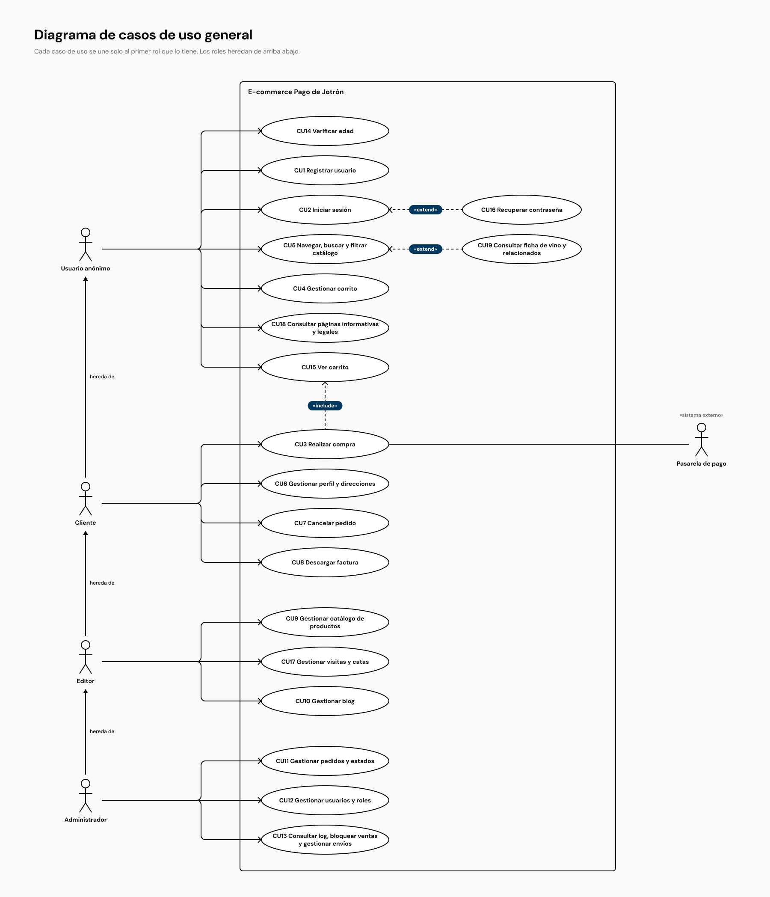

# Casos de uso (versión extendida) — E-commerce "Pago de Jotrón"

Esta es la versión de trabajo, con los 19 casos de uso descritos. La versión que entrego en la tarea es [`casos_de_uso.md`](./casos_de_uso.md), que describe solo los tres principales, como pide el enunciado.

## 1. Actores

| Actor                | Descripción                                                                                                 |
| -------------------- | ----------------------------------------------------------------------------------------------------------- |
| **Usuario anónimo**  | Persona que visita la tienda sin iniciar sesión. Puede navegar y añadir productos al carrito.               |
| **Cliente**          | Usuario registrado. Puede comprar y gestionar sus pedidos, su perfil y sus direcciones.                     |
| **Editor**           | Usuario con permisos para gestionar el catálogo, los valores asociados y el blog.                            |
| **Administrador**    | Usuario con todos los permisos del editor más la gestión de usuarios, pedidos, bloqueos y log.              |
| **Pasarela de pago** | Actor secundario (sistema externo) que procesa los pagos con tarjeta y PayPal.                              |

Los actores humanos se heredan: el cliente es un usuario anónimo que además puede comprar, el editor es un cliente que además gestiona contenidos y el administrador es un editor que además gestiona usuarios, pedidos y bloqueos.

## 2. Diagrama de casos de uso general

La fuente PlantUML está en [`casos-de-uso.puml`](./casos-de-uso.puml).

### Relaciones entre casos de uso

- **Generalización entre actores:** Cliente hereda de Usuario anónimo, Editor de Cliente y Administrador de Editor. Cada rol puede hacer todo lo del anterior, así que en el diagrama solo uno cada caso de uso con el primer rol que lo tiene.
- **CU3 Realizar compra** `<<include>>` **CU15 Ver carrito**: toda compra empieza revisando el carrito.
- **CU16 Recuperar contraseña** `<<extend>>` **CU2 Iniciar sesión**: solo entra en juego si el usuario la ha olvidado.
- **CU19 Consultar ficha de vino** `<<extend>>` **CU5 Navegar catálogo**: ocurre cuando el usuario abre un producto desde los resultados.

La **pasarela de pago** se asocia al CU3 como actor externo; la aplicación solo guarda el resultado que le devuelve.

## 3. Descripción de los casos de uso

### CU14 Verificar edad

| CAMPO             | DESCRIPCIÓN                                                                                                                              |
| ----------------- | ---------------------------------------------------------------------------------------------------------------------------------------- |
| Actor principal   | Usuario anónimo                                                                                                                          |
| Descripción breve | Verifica si el usuario es mayor de edad para poder acceder al contenido relacionado con alcohol.                                         |
| Precondiciones    | El usuario es anónimo o no ha verificado aún su edad.                                                                                    |
| Pasos habituales  | 1. El usuario introduce su fecha de nacimiento. 2. El sistema comprueba que tiene 18 años o más. 3. El sistema registra la verificación. |
| Postcondiciones   | El usuario puede acceder al contenido relacionado con alcohol.                                                                           |
| Excepciones       | El usuario no supera la edad mínima y se le deniega el acceso; fecha de nacimiento inválida.                                             |

### CU1 Registrar usuario

| CAMPO             | DESCRIPCIÓN                                                                                                                                                                                                              |
| ----------------- | ------------------------------------------------------------------------------------------------------------------------------------------------------------------------------------------------------------------------ |
| Actor principal   | Usuario anónimo                                                                                                                                                                                                          |
| Descripción breve | El usuario crea una cuenta de cliente con su fecha de nacimiento, email y contraseña.                                                                                                                                    |
| Precondiciones    | Haber superado la verificación de edad y estar en la pantalla de registro.                                                                                                                                               |
| Pasos habituales  | 1. Acceder al formulario de registro. 2. Introducir **fecha de nacimiento**, email y contraseña segura. 3. Aceptar la política de privacidad. 4. Confirmar el registro. 5. El sistema comprueba que tiene 18 años o más. |
| Postcondiciones   | Cuenta creada con rol **cliente** y correo de confirmación enviado.                                                                                                                                                      |
| Excepciones       | Email ya registrado; contraseña poco segura; el usuario es menor de 18 años (no se crea la cuenta); no acepta la política de privacidad.                                                                                 |

### CU16 Recuperar contraseña

| CAMPO             | DESCRIPCIÓN                                                                                                                                                                            |
| ----------------- | -------------------------------------------------------------------------------------------------------------------------------------------------------------------------------------- |
| Actor principal   | Usuario anónimo (cliente, editor o administrador con sesión cerrada)                                                                                                                   |
| Descripción breve | El usuario recupera y resetea su contraseña cuando la ha olvidado.                                                                                                                     |
| Precondiciones    | Tener una cuenta registrada y no haber iniciado sesión.                                                                                                                                |
| Pasos habituales  | 1. Solicitar la recuperación desde el inicio de sesión. 2. El sistema envía un enlace temporal por correo. 3. El usuario establece una nueva contraseña segura. 4. Confirma el cambio. |
| Postcondiciones   | La nueva contraseña queda activa y el usuario puede iniciar sesión.                                                                                                                    |
| Excepciones       | Email no registrado: el mensaje es el mismo que si existiera, para no dar pistas de qué correos están dados de alta; enlace caducado; contraseña poco segura.                          |

### CU2 Iniciar sesión

| CAMPO             | DESCRIPCIÓN                                                                                                                                                                                  |
| ----------------- | -------------------------------------------------------------------------------------------------------------------------------------------------------------------------------------------- |
| Actor principal   | Cliente, editor o administrador                                                                                                                                                              |
| Descripción breve | El usuario se autentica con su email y contraseña y accede a su área según su rol.                                                                                                           |
| Precondiciones    | Tener una cuenta registrada y activa.                                                                                                                                                        |
| Pasos habituales  | 1. Acceder al formulario de inicio de sesión. 2. Introducir email y contraseña. 3. El sistema valida las credenciales y el rol. 4. Se inicia la sesión y se muestra el área correspondiente. |
| Postcondiciones   | Sesión iniciada con los permisos del rol.                                                                                                                                                    |
| Excepciones       | Credenciales incorrectas; cuenta desactivada; contraseña olvidada (extiende a CU16).                                                                                                        |

### CU3 Realizar compra

| CAMPO             | DESCRIPCIÓN                                                                                                                                                                                                                                                                                                                                                                                                                                                                                           |
| ----------------- | ----------------------------------------------------------------------------------------------------------------------------------------------------------------------------------------------------------------------------------------------------------------------------------------------------------------------------------------------------------------------------------------------------------------------------------------------------------------------------------------------------- |
| Actor principal   | Cliente                                                                                                                                                                                                                                                                                                                                                                                                                                                                                               |
| Descripción breve | El cliente confirma los productos del carrito, introduce los datos de envío, elige el tipo de envío y paga con tarjeta, PayPal o transferencia.                                                                                                                                                                                                                                                                                                                                                       |
| Precondiciones    | Sesión iniciada; productos en el carrito con **stock disponible**; ser mayor de edad.                                                                                                                                                                                                                                                                                                                                                                                                                 |
| Pasos habituales  | 1. Acceder al checkout desde el carrito. 2. Revisar o introducir los datos de envío. 3. Seleccionar el **tipo de envío**. 4. Elegir el método de pago (tarjeta, **PayPal** o **transferencia**). 5. Confirmar la compra. 6. Con tarjeta o PayPal, la **pasarela** procesa el pago y devuelve el resultado; con transferencia, el sistema muestra los datos de la cuenta. 7. El sistema crea el pedido (**Confirmado**, o **Pendiente de pago** si es por transferencia) y envía el correo al cliente. |
| Postcondiciones   | Pedido registrado como **Confirmado** o **Pendiente de pago**; stock descontado en la misma operación; correo enviado al cliente.                                                                                                                                                                                                                                                                                                                                                                     |
| Excepciones       | Pago rechazado por la pasarela; stock insuficiente al confirmar; otro cliente se lleva la última unidad mientras paga: no se crea el pedido ni se cobra y se avisa de que el producto se ha agotado durante la compra; datos de envío incompletos.                                                                                                                                                                                                                                                    |

### CU4 Gestionar carrito

| CAMPO             | DESCRIPCIÓN                                                                                                                              |
| ----------------- | ---------------------------------------------------------------------------------------------------------------------------------------- |
| Actor principal   | Usuario anónimo o cliente                                                                                                                |
| Descripción breve | El usuario añade productos, modifica cantidades, elimina elementos o vacía el carrito mientras haya stock.                               |
| Precondiciones    | Haber superado la verificación de edad y existir productos en el catálogo.                                                               |
| Pasos habituales  | 1. Añadir un producto al carrito. 2. Modificar cantidades. 3. Eliminar elementos o vaciar el carrito. 4. Consultar el total actualizado. |
| Postcondiciones   | Carrito actualizado y total recalculado.                                                                                                 |
| Excepciones       | La cantidad supera el stock disponible; el producto se da de baja mientras está en el carrito.                                           |

### CU15 Ver carrito

| CAMPO             | DESCRIPCIÓN                                                                                               |
| ----------------- | --------------------------------------------------------------------------------------------------------- |
| Actor principal   | Usuario anónimo o cliente                                                                                 |
| Descripción breve | El usuario consulta el contenido actual y el total de su carrito de compras.                              |
| Precondiciones    | Haber añadido productos al carrito.                                                                       |
| Pasos habituales  | 1. Seleccionar "Ver carrito". 2. El sistema muestra las líneas del carrito, cantidades, subtotal y total. |
| Postcondiciones   | El usuario puede visualizar el carrito y su total.                                                        |
| Excepciones       | El carrito está vacío: se muestra un mensaje claro con el enlace al catálogo.                             |

### CU5 Navegar, buscar y filtrar el catálogo

| CAMPO             | DESCRIPCIÓN                                                                                                                                                                           |
| ----------------- | ------------------------------------------------------------------------------------------------------------------------------------------------------------------------------------- |
| Actor principal   | Usuario anónimo o cliente                                                                                                                                                             |
| Descripción breve | El usuario navega por el catálogo, busca por texto y filtra los vinos por una o varias características.                                                                               |
| Precondiciones    | Haber superado la verificación de edad y estar en la tienda.                                                                                                                          |
| Pasos habituales  | 1. Consultar el catálogo. 2. Buscar por nombre o descripción. 3. Filtrar por denominación de origen, bodega, tipo de uva, tipología, precio o añada. 4. Ver los resultados paginados. |
| Postcondiciones   | Se muestran los productos que cumplen la búsqueda y los filtros.                                                                                                                      |
| Excepciones       | Sin resultados en la búsqueda o el filtro; se muestra un mensaje claro y sugerencias de cambio.                                                                                       |

### CU19 Consultar ficha de vino y vinos relacionados

| CAMPO             | DESCRIPCIÓN                                                                                                                                                                                                                 |
| ----------------- | --------------------------------------------------------------------------------------------------------------------------------------------------------------------------------------------------------------------------- |
| Actor principal   | Usuario anónimo o cliente                                                                                                                                                                                                   |
| Descripción breve | El usuario abre la ficha de un producto y ve sus datos, sus presentaciones, los vinos relacionados y los artículos del blog asociados.                                                                                      |
| Precondiciones    | Haber superado la verificación de edad; el producto no está dado de baja ni bloqueado.                                                                                                                                      |
| Pasos habituales  | 1. Seleccionar un producto del catálogo. 2. El sistema muestra sus datos y su **presentación** (formato, precio y stock). 3. Muestra **vinos relacionados** y artículos asociados. 4. El usuario puede añadirlo al carrito. |
| Postcondiciones   | Ficha mostrada con sus recomendaciones según el historial de compras del cliente; si no lo hay o no hay suficientes, se completan con una selección aleatoria.                                                                                                       |
| Excepciones       | Producto agotado: se muestra como agotado y no se puede añadir al carrito; producto bloqueado o inexistente: página no encontrada.                                                                                          |

### CU6 Gestionar perfil y direcciones

| CAMPO             | DESCRIPCIÓN                                                                                                                          |
| ----------------- | ------------------------------------------------------------------------------------------------------------------------------------ |
| Actor principal   | Cliente                                                                                                                              |
| Descripción breve | El cliente modifica sus datos personales, gestiona sus direcciones de envío y facturación y, si lo desea, se da de baja.             |
| Precondiciones    | Sesión iniciada como cliente.                                                                                                        |
| Pasos habituales  | 1. Acceder a su perfil. 2. Modificar datos personales. 3. Añadir, modificar o eliminar direcciones. 4. Darse de baja si lo solicita. |
| Postcondiciones   | Cambios guardados; en caso de baja, cuenta desactivada, datos anonimizados y sesión cerrada.                                         |
| Excepciones       | Email ya utilizado por otra cuenta; confirmación requerida antes de la baja; no se puede dar de baja con pedidos en curso.           |

### CU7 Cancelar pedido

| CAMPO             | DESCRIPCIÓN                                                                                                                                                                |
| ----------------- | -------------------------------------------------------------------------------------------------------------------------------------------------------------------------- |
| Actor principal   | Cliente                                                                                                                                                                    |
| Descripción breve | El cliente cancela un pedido que aún no ha salido del almacén durante las primeras 24 horas desde su creación.                                                                     |
| Precondiciones    | El pedido está en **Pendiente de pago** (sin plazo), o en **Confirmado** o **En proceso** con menos de 24 horas desde su creación.                                                                                   |
| Pasos habituales  | 1. Consultar el pedido en su perfil. 2. Cancelarlo y confirmar. 3. El sistema lo pasa a **Anulado** (por cliente), devuelve las unidades al stock y el importe al cliente. |
| Postcondiciones   | Pedido anulado, con indicación de que lo canceló el cliente.                                                                                                               |
| Excepciones       | Han pasado más de 24 horas; el pedido ya ha salido del almacén.                                                                                                              |

### CU8 Descargar factura

| CAMPO             | DESCRIPCIÓN                                                                                                 |
| ----------------- | ----------------------------------------------------------------------------------------------------------- |
| Actor principal   | Cliente                                                                                                     |
| Descripción breve | El cliente descarga la factura de un pedido completado.                                                     |
| Precondiciones    | El pedido está en estado **Entregado** o completado.                                                        |
| Pasos habituales  | 1. Consultar los pedidos en su perfil. 2. Seleccionar el pedido completado. 3. Descargar la factura en PDF. |
| Postcondiciones   | Factura descargada.                                                                                         |
| Excepciones       | El pedido no está completado; no existe factura para ese pedido.                                            |

### CU9 Gestionar catálogo de productos

| CAMPO             | DESCRIPCIÓN                                                                                                                                                                                                                        |
| ----------------- | ---------------------------------------------------------------------------------------------------------------------------------------------------------------------------------------------------------------------------------- |
| Actor principal   | Editor o administrador                                                                                                                                                                                                             |
| Descripción breve | El editor o administrador da de alta, modifica, da de baja, lista y busca productos, y gestiona los valores asociados (bodegas, denominaciones de origen, tipos de uva) y el stock.                                                |
| Precondiciones    | Sesión iniciada con rol **editor** o **administrador**.                                                                                                                                                                            |
| Pasos habituales  | 1. Listar o buscar productos. 2. Dar de alta un producto con sus características, incluida su **presentación o formato** (p. ej. 75 cl, 1 kg). 3. Modificarlo o darle de baja. 4. Actualizar los valores asociados y el **stock**. |
| Postcondiciones   | Catálogo actualizado y reflejado en la tienda.                                                                                                                                                                                     |
| Excepciones       | Acceso denegado si no se tiene el rol; impedir la baja de un producto con pedidos activos; validación de datos incorrecta.                                                                                                         |

### CU17 Gestionar visitas y catas

| CAMPO             | DESCRIPCIÓN                                                                                                                              |
| ----------------- | ---------------------------------------------------------------------------------------------------------------------------------------- |
| Actor principal   | Editor o administrador                                                                                                                   |
| Descripción breve | El editor o administrador da de alta, modifica y da de baja las visitas y catas, tratadas como productos (precio, fecha y plazas).       |
| Precondiciones    | Sesión iniciada con rol **editor** o **administrador**.                                                                                  |
| Pasos habituales  | 1. Listar o buscar visitas y catas. 2. Crear o editar una con sus datos, fecha, plazas y precio. 3. Publicarla o retirarla del catálogo. |
| Postcondiciones   | La visita o cata aparece como producto en el catálogo y puede añadirse al carrito.                                                       |
| Excepciones       | Acceso denegado si no se tiene el rol; fechas pasadas o inválidas; superar plazas disponibles.                                           |

### CU10 Gestionar blog

| CAMPO             | DESCRIPCIÓN                                                                                                                              |
| ----------------- | ---------------------------------------------------------------------------------------------------------------------------------------- |
| Actor principal   | Editor o administrador                                                                                                                   |
| Descripción breve | El editor o administrador crea, modifica y elimina artículos y los asocia a vinos, bodegas, tipologías o denominaciones de origen.                   |
| Precondiciones    | Sesión iniciada con rol **editor** o **administrador**.                                                                                  |
| Pasos habituales  | 1. Listar los artículos. 2. Crear o editar un artículo. 3. Asociarlo a un vino, bodega o denominación de origen. 4. Publicar o eliminar. |
| Postcondiciones   | Blog actualizado; los artículos asociados aparecen como contenido relacionado en las fichas de los vinos.                                |
| Excepciones       | Acceso denegado si no se tiene el rol; campos obligatorios vacíos; si el vino no tiene artículos, se muestran artículos aleatorios.      |

### CU18 Consultar páginas informativas y legales

| CAMPO             | DESCRIPCIÓN                                                                                                                                                   |
| ----------------- | ------------------------------------------------------------------------------------------------------------------------------------------------------------- |
| Actor principal   | Usuario anónimo (y cualquier usuario)                                                                                                                         |
| Descripción breve | El usuario lee las páginas de la bodega (historia, contacto, preguntas frecuentes) y las legales (aviso legal, privacidad, cookies, condiciones de compra). |
| Precondiciones    | Ninguna. No hace falta iniciar sesión.                                                                                                                        |
| Pasos habituales  | 1. Abrir el enlace desde la portada, el menú o el pie de página. 2. Leer el contenido. 3. Volver a la tienda.                                                 |
| Postcondiciones   | El usuario ha consultado la información. El sistema no guarda nada.                                                                                           |
| Excepciones       | Dirección que no existe: página no encontrada con enlace a la portada.                                                                                        |

Las páginas son **estáticas**: su contenido va en el código y no se edita desde el panel. Por eso este caso de uso no tiene parte de gestión.

### CU11 Gestionar pedidos y estados

| CAMPO             | DESCRIPCIÓN                                                                                                                                                                                                                                                                            |
| ----------------- | -------------------------------------------------------------------------------------------------------------------------------------------------------------------------------------------------------------------------------------------------------------------------------------- |
| Actor principal   | Administrador                                                                                                                                                                                                                                                                          |
| Descripción breve | El administrador lista y busca pedidos, actualiza su estado y resuelve los pedidos bloqueados.                                                                                                                                                                                         |
| Precondiciones    | Sesión iniciada con rol **administrador**.                                                                                                                                                                                                                                             |
| Pasos habituales  | 1. Listar o buscar pedidos. 2. Consultar el detalle. 3. Avanzar el estado (Confirmado → En proceso → Preparado → Enviado → Entregado) o anularlo. 4. Si el pedido solo contiene eventos, pasarlo a **Entregado** cuando se celebran. 5. Revisar y resolver los pedidos **Bloqueados**. |
| Postcondiciones   | Estado actualizado; si se anula, las unidades vuelven al stock; pedido bloqueado resuelto por revisión.                                                                                                                                                                                |
| Excepciones       | Pedido **Bloqueado** que exige revisión previa; más de 15 días en un estado.                                                                                                                                                                                                           |

### CU12 Gestionar usuarios y roles

| CAMPO             | DESCRIPCIÓN                                                                                                             |
| ----------------- | ----------------------------------------------------------------------------------------------------------------------- |
| Actor principal   | Administrador                                                                                                           |
| Descripción breve | El administrador gestiona los usuarios de la plataforma y cambia su tipo de rol.                                        |
| Precondiciones    | Sesión iniciada con rol **administrador**.                                                                              |
| Pasos habituales  | 1. Listar y buscar usuarios. 2. Consultar su estado y rol. 3. Cambiar el tipo de rol. 4. Desactivar cuentas. |
| Postcondiciones   | Roles y cuentas actualizados; cambios registrados en el log.                                                            |
| Excepciones       | No se puede eliminar ni degradar al **último administrador**; impedido de modificar su propio rol si es el último.      |

### CU13 Consultar log, bloquear ventas y gestionar envíos

| CAMPO             | DESCRIPCIÓN                                                                                                                                                                                                      |
| ----------------- | ---------------------------------------------------------------------------------------------------------------------------------------------------------------------------------------------------------------- |
| Actor principal   | Administrador                                                                                                                                                                                                    |
| Descripción breve | El administrador consulta el log de acciones, bloquea las ventas de determinados productos, bodegas o denominaciones de origen y gestiona los tipos de envío.                                                                                 |
| Precondiciones    | Sesión iniciada con rol **administrador**.                                                                                                                                                                       |
| Pasos habituales  | 1. Consultar el log de acciones. 2. Seleccionar un producto, bodega o denominación de origen. 3. Bloquear o desbloquear su venta. 4. Dar de alta, modificar o desactivar tipos de envío (nombre y coste). 5. El sistema registra la acción.                                              |
| Postcondiciones   | Venta bloqueada o desbloqueada; lo bloqueado deja de verse en la tienda y, si es una bodega o una denominación de origen, también sus vinos; tipos de envío actualizados en el checkout; acción registrada.                                                  |
| Excepciones       | Acceso denegado si no se tiene el rol; no se pueden bloquear elementos activos en pedidos en curso sin confirmación; no se puede desbloquear un vino si su bodega o su denominación de origen siguen bloqueadas; no se puede quitar el último tipo de envío activo. |

## 4. Trazabilidad requisitos ↔ casos de uso

| Requisito funcional                                | Casos de uso                                            |
| -------------------------------------------------- | ------------------------------------------------------- |
| RF1 Roles y control de acceso                      | Actores del diagrama; CU2, CU12                      |
| RF2 Verificación de edad, registro y autenticación | CU14, CU1, CU16, CU2                              |
| RF3 Perfil y direcciones                           | CU6                                                   |
| RF4 Catálogo y productos                           | CU5, CU19, CU9, CU17                              |
| RF5 Búsqueda y filtros                             | CU5                                                   |
| RF6 Carrito                                        | CU4, CU15                                            |
| RF7 Compra y pago                                  | CU3                                                   |
| RF8 Pedidos y sus estados                          | CU7, CU8, CU11                                     |
| RF9 Vinos relacionados                             | CU19                                                   |
| RF10 Blog                                          | CU10, CU19                                            |
| RF11 Páginas informativas y legales                | CU18                                                   |
| RF12 Administración avanzada                       | CU12, CU13                                            |
| RF13 Interfaz y navegación                         | Cubierto por los requisitos no funcionales (RNF2, RNF6) |

Del RF12, los usuarios y roles se gestionan en el CU12, y los bloqueos de venta, los tipos de envío y el log, en el CU13.

El RNF3 (seguridad) aparece en las excepciones de los casos de uso de gestión, donde se deniega el acceso si no se tiene el rol, y en la protección del último administrador del CU12.
