# 4. Diseño de la interfaz de la aplicación

## Diagrama de páginas, elementos, enlaces y flujo de datos

Para este apartado he dibujado el mapa de la tienda en Figma, en la página *Diagrama* del mismo archivo donde están los diseños de la tienda y del panel. Hay dos versiones. El [mapa visual](https://www.figma.com/design/Q48fEy5Kzr16Tu4rjajUtO/Jotron-26-27?node-id=2009-54820) es el diagrama principal: cada página es una tarjeta con su wireframe y se ve de un vistazo cómo se llega de una a otra. El [diagrama completo](https://www.figma.com/design/Q48fEy5Kzr16Tu4rjajUtO/Jotron-26-27?node-id=2021-1247) lo dejo como anexo, porque lleva más detalle (elementos, enlaces y tablas de cada página) pero cuesta más de leer.

Para hacerlo he partido de las pantallas del RF13, de los casos de uso y del modelo de datos. Después he comparado las páginas con las rutas que ya existen en el código.

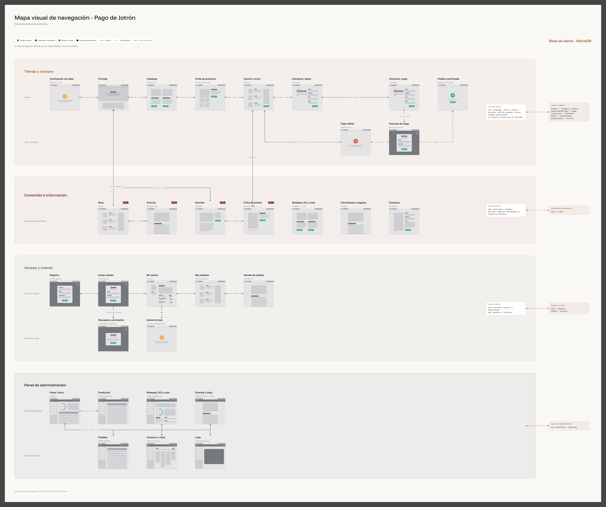

*Mapa visual de la tienda y del panel (Figma).*

### Diagrama de flujo

El mapa enseña las pantallas, pero no las decisiones que cambian el camino. Para eso añado un [diagrama de flujo](https://www.figma.com/design/Q48fEy5Kzr16Tu4rjajUtO/Jotron-26-27?node-id=2230-1469) con las cuatro decisiones clave: la **edad**, la **sesión**, el **pago** y el **rol**. Las cajas son pantallas, los rombos son decisiones y las cajas discontinuas repiten una pantalla que ya sale en otro punto.

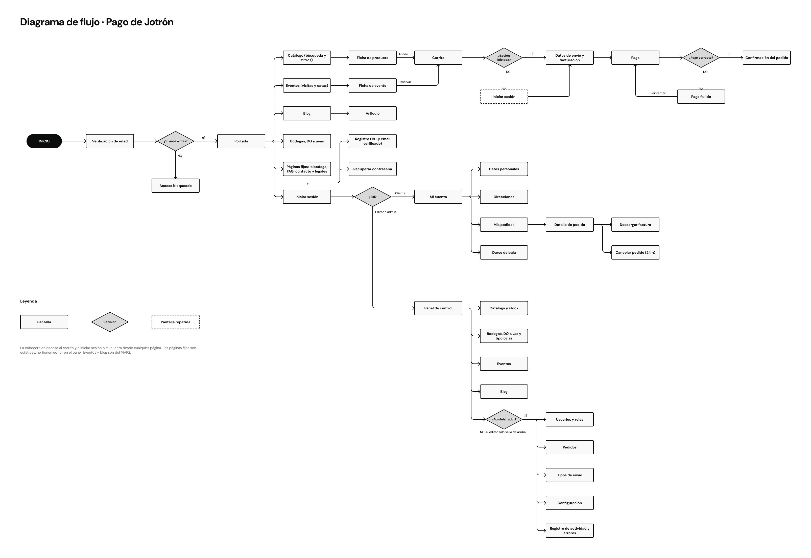

*Diagrama de flujo con las decisiones principales (Figma).*

### Diseños completos

Todos los diseños están en Figma y se pueden consultar completos: [tienda (front)](https://www.figma.com/design/Q48fEy5Kzr16Tu4rjajUtO/Jotron-26-27?node-id=938-616) y [panel de administración (admin)](https://www.figma.com/design/Q48fEy5Kzr16Tu4rjajUtO/Jotron-26-27?node-id=1061-10458).

## 1. Cómo se lee

- Cada **tarjeta** es una página. Encima lleva su nombre y su ruta.
- Las **flechas continuas** son enlaces o botones que llevan de una página a otra. El texto de la flecha dice qué botón se pulsa.
- Las **flechas discontinuas** son flujo de datos: con la pasarela de pago o con la base de datos.
- Las páginas del **blog** y de los **eventos** llevan la etiqueta MVP2, porque se cierran en la segunda entrega.
- Los colores separan las cuatro zonas: compra, contenido, acceso y cuenta, y panel.

La cabecera, el pie y el banner de cookies no tienen tarjeta propia porque salen en todas las páginas. Los describo al final de este apartado.

## 2. Páginas, por zonas

En cada página enumero los elementos en el orden en que aparecen en pantalla, de arriba abajo.

### 2.1 Tienda y compra

**Verificación de edad.** Es lo primero que ve un visitante nuevo (RF2).
1. Logo y imagen de la bodega.
2. Aviso de que solo pueden pasar los mayores de 18 años.
3. Campo de fecha de nacimiento.
4. Botón *Entrar*, que lleva a la portada.

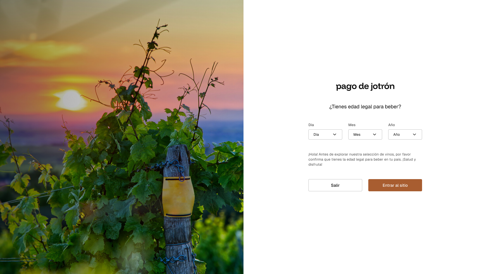

*Verificación de edad.*

**Portada** (`/`).
1. Cabecera.
2. Imagen principal con el botón *Ver vinos*.
3. Colecciones por tipología.
4. Los vinos más vendidos.
5. Banner *Visita la bodega*, que lleva a los eventos.
6. Más productos de la tienda.
7. Bloques sobre la bodega.
8. Últimas noticias del blog.
9. Pie de página.

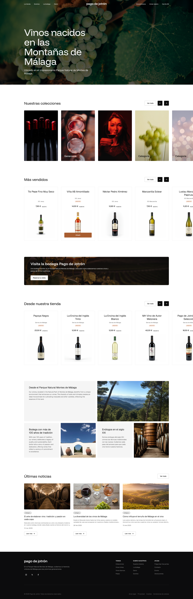

*Portada de la tienda.*

**Catálogo** (`/productos`).
1. Buscador.
2. Filtros: denominación de origen, bodega, uva, tipología, precio y añada (RF5).
3. Rejilla de productos, con imagen, nombre, precio y botón de añadir.
4. Paginación.
5. Si no hay resultados, un mensaje y un botón para quitar los filtros.

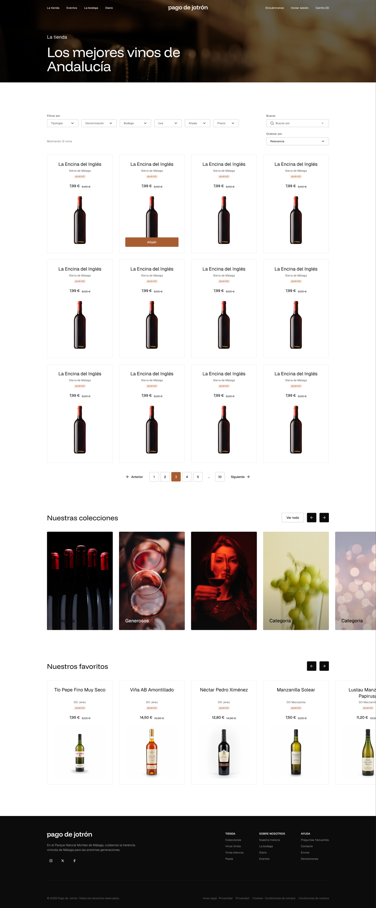

*Catálogo con filtros.*

**Ficha de producto** (`/productos/[slug]`).
1. Imágenes.
2. Nombre, bodega, denominación de origen y precio.
3. Presentación (por ejemplo 75 cl) y stock. Si no hay, aparece *Agotado*.
4. Cantidad y botón *Añadir al carrito*.
5. Ficha técnica, notas de cata y maridaje.
6. Vinos y artículos relacionados (RF9 y RF10).

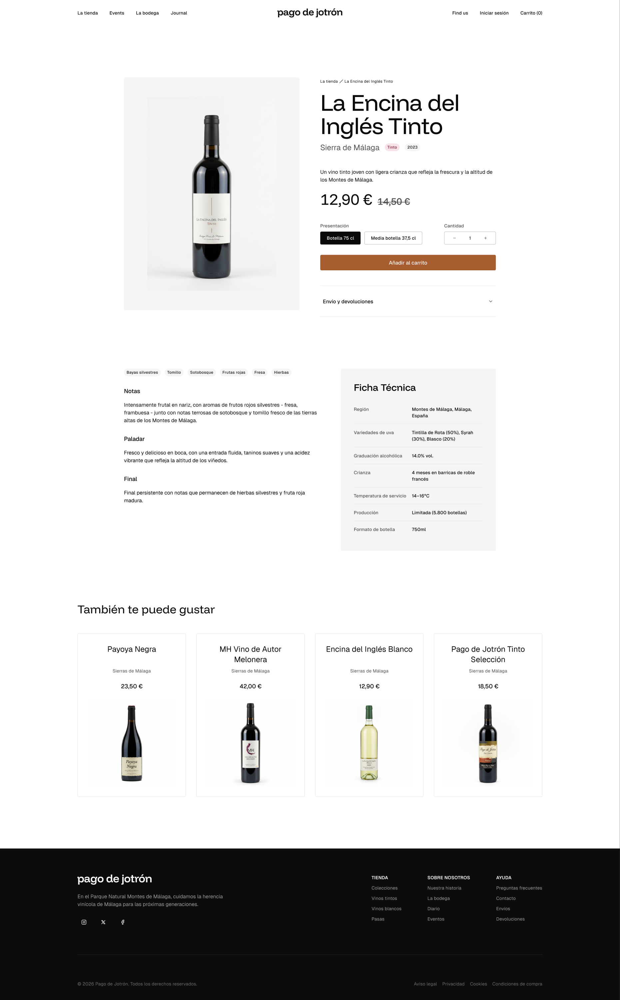

*Ficha de producto.*

**Carrito** (`/carrito`).
1. Líneas con imagen, nombre y precio.
2. Cantidad y botón de eliminar.
3. Tipo de envío (estándar o exprés) con su coste.
4. Subtotal con IVA.
5. Botones *Seguir comprando* y *Finalizar compra*. Si no hay sesión, el segundo lleva al login.

El carrito es el **paso 1** de la compra. El checkout (`/checkout`) sigue con dos pasos más, como en el diseño:
2. **Datos:** contacto y direcciones guardadas o una nueva (solo España), con la de facturación.
3. **Pago:** tarjeta, PayPal o transferencia (las dos últimas, MVP2) y botón *Realizar pedido*.

El paso 4 es la confirmación. En todos va el resumen del pedido a un lado.

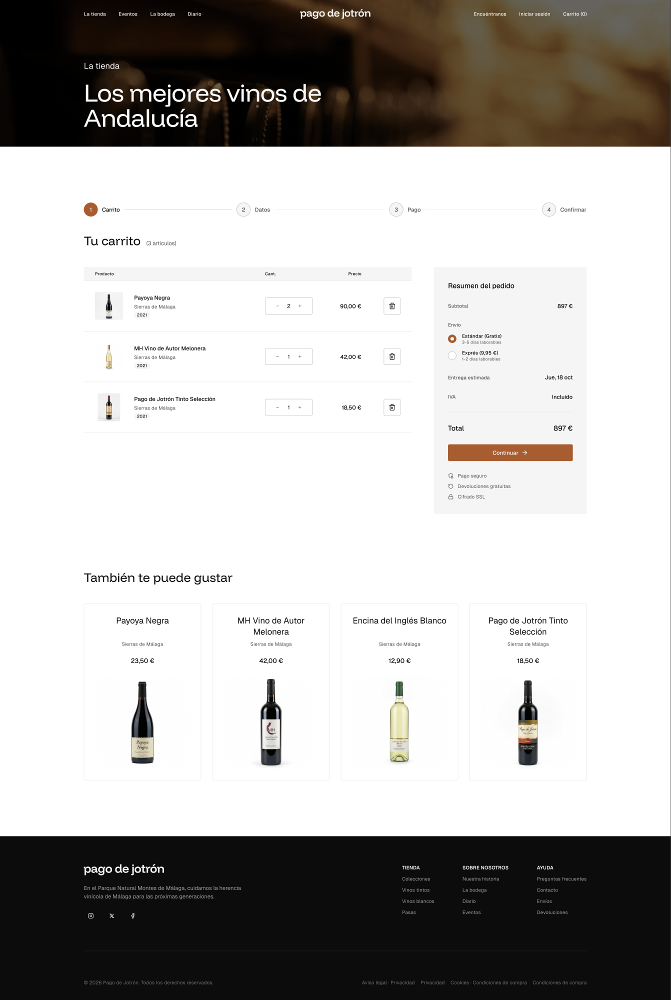

*Checkout, paso del carrito.*

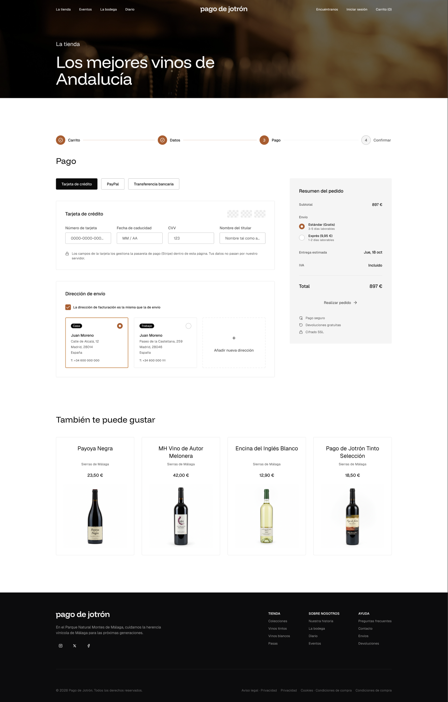

*Checkout, paso de pago.*

**Pasarela de pago.** No es una página nuestra. Sus campos seguros van integrados en el paso de pago, pero los sirve el servicio externo. Los datos de la tarjeta nunca pasan por mi servidor (RNF3).

**Pedido confirmado** (`/pedido/confirmado`).
1. Icono de confirmación.
2. Número de pedido y resumen.
3. Botones *Ver mi pedido* y *Seguir comprando*.

**Pago fallido** (`/pedido/fallo`).
1. Icono de error y motivo.
2. Botón *Volver al carrito*. El carrito se conserva tal cual.

### 2.2 Contenido e información

- **Blog** (`/blog`, MVP2): filtro por categoría, tarjetas de artículos y paginación.
- **Artículo** (`/blog/[slug]`, MVP2): título, fecha, imagen, texto y vinos relacionados.
- **Eventos** (`/eventos`, MVP2): tarjetas con fecha, plazas y precio.
- **Ficha de evento** (`/eventos/[id]`, MVP2): imagen, fecha y lugar, programa de actos, plazas libres y botón *Reservar*, que lo añade al carrito.
- **Bodegas, denominaciones y uvas:** listados con imagen y descripción. Desde una bodega se llega a sus vinos en el catálogo.
- **Páginas informativas y legales** (`/[slug]`): la bodega, preguntas frecuentes, aviso legal, privacidad, cookies y condiciones de compra. Son estáticas: el texto va en el código y no se edita desde el panel.
- **Contacto** (`/contacto`): datos de la bodega, formulario (nombre, email y mensaje) y botón *Enviar*.

### 2.3 Acceso y área de cliente

**Iniciar sesión** (`/auth/signin`).
1. Email.
2. Contraseña.
3. Botón *Entrar*.
4. Enlaces *¿Olvidaste la contraseña?* y *Crear cuenta*.

Según el rol, después del login se va a *Mi cuenta* (cliente) o al panel (editor y administrador).

**Registro** (`/auth/register`).
1. Nombre y apellidos.
2. Fecha de nacimiento. Compruebo que tenga 18 años o más.
3. Email.
4. Contraseña segura.
5. Casilla de la política de privacidad.
6. Botón *Crear cuenta*. Envía un correo de verificación.

**Recuperar y restablecer contraseña.** Primero se pide el email. El enlace temporal llega por correo y lleva a una página con la contraseña nueva y su repetición.

**Mi cuenta** (`/cuenta`). Tiene un menú lateral con datos, direcciones, pedidos y baja.
1. Menú lateral.
2. Formulario de datos personales.
3. Botón *Guardar*.

**Direcciones** (`/cuenta/direcciones`): tarjetas con cada dirección, botones de editar y eliminar, y *Añadir nueva*.

**Mis pedidos** (`/cuenta/pedidos`): lista con número, fecha, total y estado. Si no hay, un mensaje de que todavía no hay pedidos.

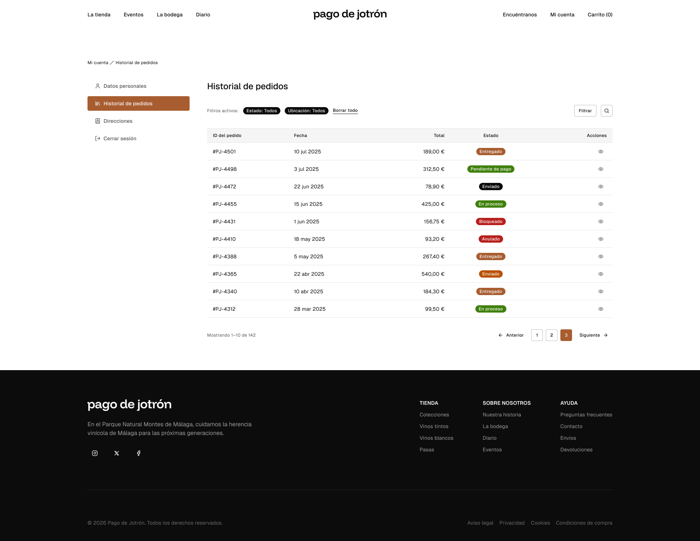

*Mi cuenta, historial de pedidos.*

**Detalle de pedido** (`/pedido/[número]`).
1. Estado y fechas.
2. Productos y eventos.
3. Direcciones y tipo de envío.
4. Totales con IVA.
5. Botón *Cancelar*, solo dentro de las primeras 24 horas (RF8).
6. Botón *Descargar factura*, solo si está entregado.

**Darse de baja** (`/cuenta/configuracion`): aviso de lo que se conserva (pedidos y facturas por obligación legal), confirmación y botón de baja (RF3).

### 2.4 Panel de administración

El panel cambia según el rol. Por eso lo he dibujado en dos filas.

**Editor y administrador:**
- **Inicio** (`/admin`): menú lateral, indicadores, últimos pedidos y accesos rápidos.
- **Catálogo:** buscador, tabla de productos y botones de nuevo, editar y dar de baja.
- **Editar producto:** tipo (vino o pasa), datos generales, ficha del vino, presentación, precio, stock, imagen y *Guardar*.
- **Valores asociados:** bodegas, denominaciones de origen, uvas y tipologías.
- **Eventos y blog:** lista y formulario de cada uno.

**Solo administrador:**
- **Pedidos:** filtros por estado, tabla, detalle, cambio de estado y confirmación de transferencias.
- **Usuarios y roles:** buscador, tabla y cambio de rol. Nunca se puede quitar al último administrador (RF12).
- **Bloqueo y envíos:** bloquear ventas de un producto, una bodega o una denominación, y gestionar los tipos de envío.
- **Logs:** log de acciones (quién, qué y cuándo) y log de errores.

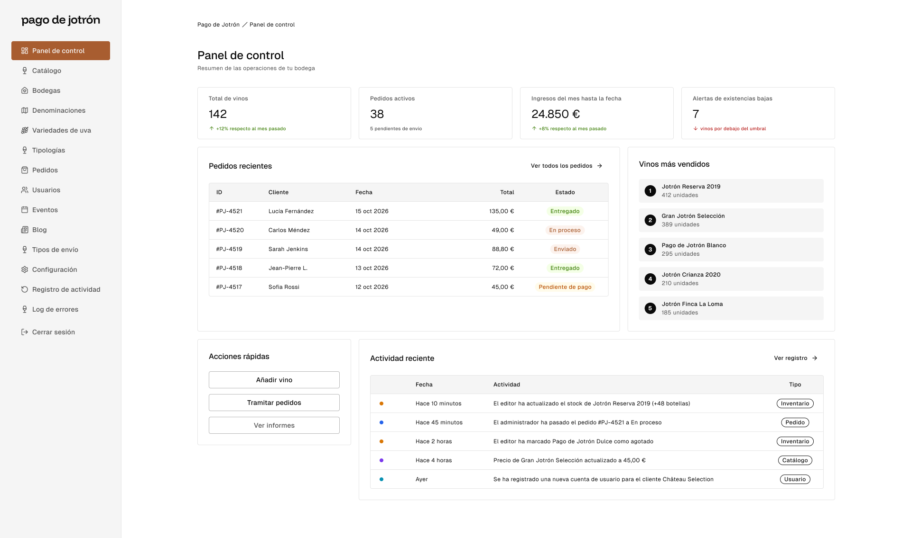

*Panel de control del administrador.*

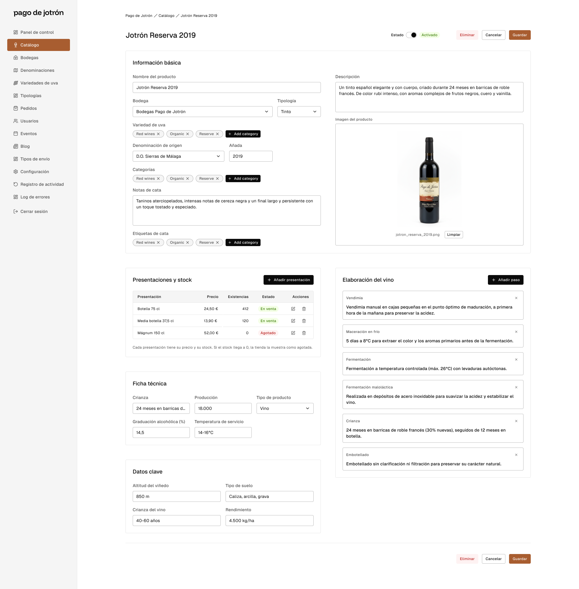

*Panel, edición de un producto con sus presentaciones y stock.*

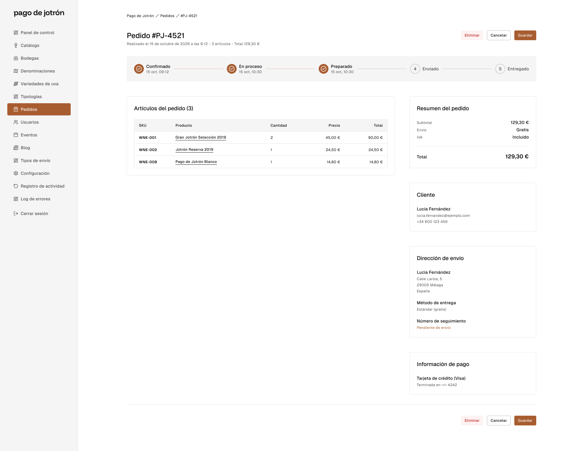

*Panel, detalle de un pedido con su estado.*

### 2.5 Elementos comunes

- **Cabecera:** logo, menú (La tienda, Eventos, La bodega, Diario), buscador, *Iniciar sesión* o *Mi cuenta*, carrito con contador y, solo para editor y administrador, el acceso al panel.
- **Pie:** datos de la bodega, redes y enlaces legales.
- **Banner de cookies:** aparece en la primera visita con *Aceptar*, *Rechazar* y *Configurar* (RNF7).

## 3. Flujo de datos

Cada zona tiene un bloque a la derecha con lo que lee y escribe, unido con una flecha discontinua a la base de datos. Los flujos más importantes son estos:

- **Carrito:** al añadir un producto o reservar un evento se escribe en `CartProduct` o `CartEvent`.
- **Pago:** el checkout manda el importe a la pasarela y esta devuelve el resultado. Con él decido si el pedido se crea o se rechaza.
- **Pedido:** al confirmarse el pago creo el pedido y descuento el stock en la misma transacción (RNF4). Así, la última unidad es para quien termina primero.
- **Panel y tienda:** lo que se cambia en el panel se ve en la tienda. Un producto bloqueado o dado de baja desaparece del catálogo.
- **Auditoría:** cada acción de gestión queda en `AuditLog`.

## 4. Decisiones y límites

- **Pocas páginas en el mapa visual.** Dibujo el recorrido principal de cada zona y no todas las pantallas. El resto de detalle está en el diagrama completo.
- **Tarjetas reutilizadas.** El kit de wireframes no tiene carrito, checkout ni tablas de administración. Para esas pantallas he usado la tarjeta más parecida, así que algunas se repiten. Cuando termine los diseños finales en Figma, sustituiré las tarjetas por las pantallas reales.
- **Cabecera y pie aparte.** Los explico una sola vez en lugar de repetirlos en cada página.
- **Licencia.** Las tarjetas se basan en el kit *UX Flowchart Cards* de Figma Community. Me falta comprobar su licencia antes de entregar.

## En resumen

El mapa visual me sirve para ver el recorrido completo de un cliente, desde que entra hasta que recibe la confirmación del pedido, y qué parte del panel toca cada dato. Lo que más cuidado me va a exigir al programarlo es el flujo de pago, porque es donde se cruzan la pasarela, el stock y el correo de confirmación.
