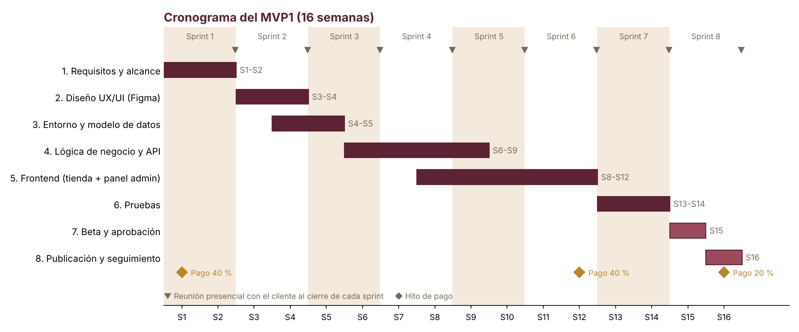

# Planificación del proyecto — E-commerce "Pago de Jotrón"

## 1. Alcance

Antes de ponerme a diseñar nada dejo por escrito qué entra en el proyecto y qué no, para no encontrarme luego con que el cliente espera cosas que no habíamos hablado.

Parto el proyecto en dos iteraciones. El **MVP1** es la tienda que publico al final del cronograma y el **MVP2** es lo que añado después, con el feedback real del cliente. Los requisitos funcionales recogen el producto completo; las tablas de abajo marcan en qué iteración entra cada bloque.

### 1.1 Primera iteración (MVP1)

El MVP1 es una tienda que ya vende: el cliente puede publicar vinos y pasas, cobrar con tarjeta y gestionar los pedidos. Dejo fuera lo que no hace falta para vender, pero cumplo desde el primer día lo que exige la ley (edad, cookies y textos legales).

| Bloque                      | Qué incluye                                                                                                                                                         | Requisitos       |
| --------------------------- | ------------------------------------------------------------------------------------------------------------------------------------------------------------------- | ---------------- |
| Acceso y usuarios           | Verificación de edad, registro, inicio de sesión, recuperación de contraseña y **roles** (anónimo, cliente, editor y administrador)                                 | RF1, RF2         |
| Perfil                      | Datos personales, direcciones de envío y facturación y baja de la cuenta                                                                                            | RF3              |
| Catálogo                    | Vinos y pasas con sus presentaciones, stock, bloqueo de venta y valores asociados (bodegas, denominaciones de origen, uvas y tipologías)                            | RF4              |
| Búsqueda y filtros          | Filtros por una o varias características y búsqueda por texto                                                                                                       | RF5              |
| Carrito                     | Carrito de anónimos y clientes, que se conserva al iniciar sesión                                                                                                   | RF6              |
| Compra y pago               | Checkout con pago con **tarjeta** a través de la pasarela segura, tipos de envío configurables y envíos solo a España                                               | RF7, RNF2        |
| Pedidos                     | Estados (Confirmado, En proceso, Preparado, Enviado, Entregado, Anulado y Bloqueado), descuento de stock, cancelación en 24 horas, bloqueo a los 15 días y facturas | RF8              |
| Páginas informativas        | Portada y páginas estáticas: historia, contacto y legales (aviso legal, privacidad, cookies, condiciones de compra), con el banner de cookies                    | RF11, RNF7       |
| Panel de administración     | Usuarios y roles, pedidos, bloqueos de venta, tipos de envío y log de acciones                                                                                      | RF12, RF13       |
| Diseño, calidad y seguridad | Interfaces de **Figma** aprobadas, diseño responsive y accesible, HTTPS, copias de seguridad y tests unitarios de las reglas de negocio                             | RNF3, RNF4, RNF6 |

### 1.2 Segunda iteración (MVP2)

El MVP2 es lo que hace crecer la tienda una vez publicada. Lo concreto en la revisión de los 3 meses, según lo que haya pedido el cliente y lo que haya funcionado.

| Bloque                   | Qué incluye                                                                                                                      | Requisitos     |
| ------------------------ | -------------------------------------------------------------------------------------------------------------------------------- | -------------- |
| Más métodos de pago      | **PayPal** y **transferencia bancaria**, con el estado Pendiente de pago y la confirmación manual del cobro por el administrador | RF7, RF8, RNF2 |
| Blog                     | Artículos y categorías, asociados a vinos, bodegas, tipologías y denominaciones de origen, con su SEO (URLs claras y títulos propios) | RF10, RNF6     |
| Recomendaciones          | Vinos relacionados según el historial de compras y artículos relacionados en la ficha del vino, con selección aleatoria cuando no hay datos | RF9, RF10      |
| Visitas y catas          | Eventos como productos: fecha, horas, precio, actos y plazas, que hacen de stock                                                 | RF4, RF8       |
| Mejoras tras el feedback | Ajustes que salgan de la beta y de la revisión de los 3 meses                                                                    | Por definir    |

En resumen, el MVP1 sirve para **vender y gestionar** y el MVP2 para **vender más y atraer público**. Así llego a la publicación con lo imprescindible bien hecho y probado, en lugar de con todo a medias.

### 1.3 Fuera del alcance

- Aplicación móvil nativa: con que la web sea responsive es suficiente.
- Traducir la tienda a otros idiomas.
- Otros métodos de pago como el contrareembolso o la financiación.
- Envíos y venta fuera de España.
- Conectar con los programas que ya tenga la bodega, como un ERP o el de contabilidad.
- Un sistema de reservas aparte para las catas: se venden como un producto más.

## 2. Cronograma

Trabajo con **Scrum** en **sprints de dos semanas** y le paso un informe al cliente cada semana, para que vea por dónde voy y pueda corregir a tiempo. Calculo 16 semanas en total, unos 4 meses, hasta la publicación del MVP1.

| Fase                               | Semanas | Entregable                                                   |
| ---------------------------------- | ------- | ------------------------------------------------------------ |
| 1. Requisitos y alcance            | 1-2     | Requisitos funcionales y no funcionales aprobados            |
| 2. Diseño UX/UI (Figma)            | 3-4     | Bocetos y prototipo aprobado por el cliente                  |
| 3. Entorno y modelo de datos       | 4-5     | Base de datos y migraciones (MySQL/MariaDB + Drizzle)        |
| 4. Lógica de negocio y API         | 6-9     | Route Handlers / Server Actions y reglas de negocio          |
| 5. Frontend (tienda + panel admin) | 8-12    | Tienda responsive, checkout y panel de administración (MVP1) |
| 6. Pruebas                         | 13-14   | Test unitarios, pruebas de compra y responsive corregidas    |
| 7. Beta y aprobación               | 15      | Beta del MVP1 probada y aprobada por el cliente              |
| 8. Publicación y seguimiento       | 16      | MVP1 publicado; revisión con el cliente a los 3 meses        |

Cada sprint termina con una reunión presencial con el cliente. La fuente del diagrama es `imagenes/gantt.py`.

El mismo diagrama de Gantt está en Notion, con los sprints y los hitos de pago: [Cronograma del proyecto (Gantt)](https://app.notion.com/p/3f11b2571dd681588236c8102abfe385).

Los pagos del cliente van atados a este cronograma; los detallo en el apartado 3. El MVP2 no tiene fechas todavía: lo planifico en sprints de dos semanas después de la revisión de los 3 meses.

## 3. Recursos y coste

**Hardware:**

| Recurso                       | Detalles                                                 | Coste             |
| ----------------------------- | -------------------------------------------------------- | ----------------- |
| Equipo de desarrollo          | Portátil Intel Core i7 (o equivalente) · 16 GB RAM · SSD | 0 € (ya lo poseo) |
| Móvil para pruebas responsive | Smartphone propio                                        | 0 € (ya lo poseo) |

El servidor no lo compro: lo alquilo en la nube y lo incluyo en el hosting anual, más abajo.

**Hosting, interconexión y seguridad anual:**

| Recurso                          | Detalles                                     | Coste/año |
| -------------------------------- | -------------------------------------------- | --------- |
| Dominio (.es)                    | Empresa registradora                         | 15 €      |
| Correos electrónicos (8 cuentas) | Cuentas con duración anual                   | 50 €      |
| Servidor en la nube              | AWS o DigitalOcean · 4 vCPU · 8 GB RAM · 512 GB SSD | 600 € |
| Certificado SSL                  | Let's Encrypt (gratuito)                     | 0 €       |
| CDN y escalabilidad (opcional)   | Solo si crece el tráfico; no entra en el total | 200-300 € |

Elijo el **servidor en la nube** con 4 vCPU y 8 GB de RAM porque tiene que aguantar varias visitas a la vez sin ir lento, y el disco **SSD de 512 GB** porque el catálogo lleva bastantes imágenes de producto y se leen en cada página.

Para desarrollar uso mi propia conexión de fibra de 1 Gbps. El certificado SSL lo saco de **Let's Encrypt**, que es gratuito y suficiente para que los pagos y los datos del cliente viajen cifrados.

**Tecnologías del proyecto (libres, con versión y web de descarga):**

En la propuesta mezclaba tecnologías con herramientas. Ahora las separo y me quedo solo con lo que forma parte de la aplicación.

| Tecnología       | Versión          | Web de descarga                         | Coste |
| ---------------- | ---------------- | --------------------------------------- | ----- |
| Next.js          | 14.2             | https://nextjs.org                      | 0 €   |
| TypeScript       | 5.3              | https://typescriptlang.org              | 0 €   |
| Tailwind CSS     | 3.4              | https://tailwindcss.com                 | 0 €   |
| MySQL / MariaDB  | 8.4 LTS / 11     | https://mysql.com · https://mariadb.org | 0 €   |
| Drizzle ORM      | 0.45             | https://orm.drizzle.team                | 0 €   |
| NextAuth + Zod   | 4.24 / 3.22      | https://next-auth.js.org · https://zod.dev | 0 €   |

Next.js ya trae **React 18** y funciona sobre **Node.js 22 LTS**, así que no los cuento como tecnologías aparte. El servidor irá con **Ubuntu Server 24.04 LTS**.

**Por qué elijo cada una:**

- **Next.js 14:** tengo el frontend y la API en un solo proyecto, lo que me ahorra mantener dos. Además, el renderizado en servidor ayuda al **SEO** del catálogo, que es la forma de que la bodega llegue a más clientes.
- **TypeScript:** comparto los tipos entre el front y la API. Esto evita errores en las partes delicadas, como los estados del pedido y el stock.
- **Tailwind CSS:** me deja pasar los diseños de Figma a código rápido y hacer la tienda **responsive** sin escribir CSS a mano.
- **MySQL/MariaDB:** los datos de una tienda son relacionales (usuarios, pedidos, líneas, stock). Es la base de datos que hemos usado en el ciclo y cualquier hosting la soporta.
- **Drizzle ORM:** escribo consultas tipadas y parametrizadas, que protegen de la inyección SQL. También uso sus **transacciones** para que el stock y el pedido se actualicen a la vez (RNF4).
- **NextAuth + Zod:** NextAuth gestiona el login y los roles, y Zod valida los datos en el servidor. Así cumplo que los permisos se comprueben en el servidor (RNF3).

**Herramientas de trabajo:**

| Herramienta      | Para qué                                 | Web                                     | Coste |
| ---------------- | ---------------------------------------- | --------------------------------------- | ----- |
| VS Code          | Editor de código                         | https://code.visualstudio.com           | 0 €   |
| Git + GitHub     | Control de versiones e integración continua | https://github.com                   | 0 €   |
| Docker           | Entorno de desarrollo y despliegue igual en todas partes | https://docker.com      | 0 €   |
| Figma            | Diseños para que el cliente los apruebe  | https://figma.com                       | 0 €   |
| Notion           | Backlog y documentación (plan gratuito)  | https://notion.so                       | 0 €   |
| Google Analytics | Ver cómo se mueven los usuarios por la tienda | https://analytics.google.com       | 0 €   |

En resumen, elijo software libre para abaratar el proyecto y no depender de licencias. Además, cada tecnología responde a un requisito concreto, y las herramientas solo me sirven para trabajar, no van dentro de la aplicación.

**Software de pago:**

Para el pago con tarjeta elijo **Stripe**: no tiene cuota fija, tiene modo de pruebas y los datos de la tarjeta nunca pasan por mi servidor (PCI DSS).

| Concepto                                                 | Proveedor       | Coste                           |
| -------------------------------------------------------- | --------------- | ------------------------------- |
| Pasarela de pago con tarjeta (MVP1)                      | Stripe          | Comisión por venta (~1,5 % + 0,25 €) |
| Pago con PayPal (MVP2)                                   | PayPal          | Comisión por venta (~3,5 %)     |

**Personal y categoría profesional:**

| Perfil                    | Categoría profesional                                             | Duración | Coste mensual | Honorarios |
| ------------------------- | ----------------------------------------------------------------- | -------- | ------------- | ---------- |
| Desarrollador full-stack  | Técnico Superior en Desarrollo de Aplicaciones Web (front + back) | 4 meses  | 550 €/mes     | 2.200 €    |
| Diseñador UI/UX           | Diseñador de interfaces (diseño en Figma)                         | 1 mes    | 800 €/mes     | 800 €      |
| Administrador de sistemas | Configuración y mantenimiento del servidor                        | Puntual  | 500 € (pago único) | 500 €      |

Los tres perfiles son funciones que hago yo, como recogía la propuesta del proyecto: una sola persona que diseña y programa. La administración del servidor la hago de forma puntual, en la puesta en marcha y en el mantenimiento. Separo los honorarios por función para que el cliente vea qué paga en cada parte. Están incluidos en la línea "Desarrollo y diseño del ecommerce".

**Presupuesto:**

| Concepto                                               | Coste                      |
| ------------------------------------------------------ | -------------------------- |
| Desarrollo y diseño del ecommerce (incluye honorarios) | 3.500 € + IVA              |
| Portátil de desarrollo (ya poseído)                    | 0 €                        |
| Móvil para pruebas responsive (ya poseído)             | 0 €                        |
| Correos electrónicos (8 cuentas, anual)                | 50 €                       |
| Dominio (anual)                                        | 15 €                       |
| Servidor en la nube (anual)                            | 600 €                      |
| Certificado SSL (Let's Encrypt)                        | 0 €                        |
| CDN y escalabilidad (opcional, no incluido)            | 200-300 €/año              |
| **Total aprobado**                                     | **4.900 € (IVA incluido)** |

**Modo de financiación:** el cliente ya ha aprobado el presupuesto total de **4.900 € (IVA incluido)**. Cubre el desarrollo del MVP1; el MVP2 lo presupuesto aparte cuando lo concrete tras la revisión de los 3 meses. Lo paga en tres veces, según el cronograma:

1. **40 %** al inicio del proyecto, para cubrir los gastos iniciales de servidor y dominio.
2. **40 %** al completar la fase de diseño y desarrollo principal.
3. **20 %** a la entrega y despliegue del sitio, incluyendo las pruebas y los ajustes finales.

Además, la empresa puede pedir las ayudas al emprendimiento que ya recogía la propuesta: el espacio y las bonificaciones del **CADE** y el **Kit Digital**.

**Alternativas y posibles mejoras:**

- **Servidor:** me quedo con el servidor en la nube porque se puede ampliar sin cambiar de proveedor. El hosting compartido saldría más barato (~120 €/año) pero se queda corto, y **Vercel** con una base de datos gestionada sería el siguiente paso si la tienda crece.
- **Base de datos:** con Drizzle también podría usar **PostgreSQL**, pero me quedo con MySQL/MariaDB porque es la que hemos usado en el ciclo y la que mejor conozco. **MongoDB** no la veo aquí: los datos de una tienda son claramente relacionales.
- **Sistema web:** con **WordPress y WooCommerce** tendría la tienda mucho antes, pero se me quedaría corto para la ficha de vino y para las reglas de los pedidos, que son la parte que pide el cliente.
- **Mejoras previstas:** comprimir las imágenes automáticamente (TinyPNG), añadir **Bizum** como método de pago, traducir la tienda, automatizar más correos (por ejemplo, los cambios de estado del pedido) y mejorar el SEO del catálogo.
- **Fuera del alcance:** unificar productos y eventos en una sola tabla de líneas (`OrderLine`), en lugar de `OrderProduct` y `OrderEvent`. Los formatos de un mismo producto ya funcionan con el campo `Size` (vino de 75 cl y 37,5 cl, pasas de 1 kg y 500 g).
